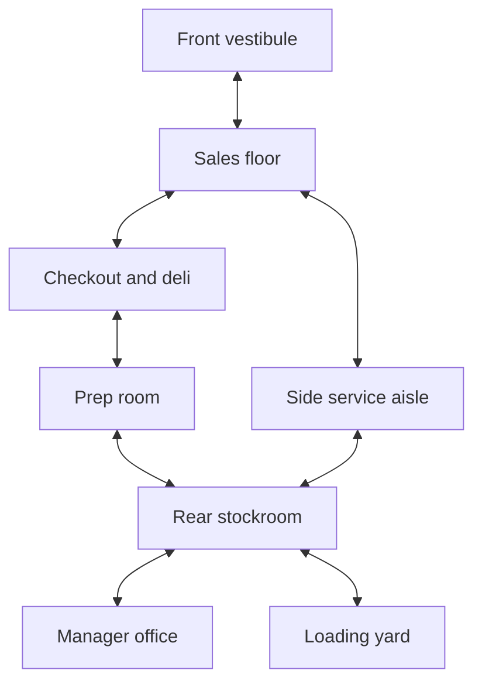

# Lived-In Levels, Clear Navigation, Good Gunfights

**Design standard for a 1–4 player cooperative PvE shooter set in 1999 Pennsylvania**  
Version 1.0 · October 21, 2026  
Audience: level designers, environment artists, encounter designers, and procedural level-building tools.  
Production context: Blender asset creation and Godot integration, including the project's Godot 4.7 target.

> **Build a place people could use before the heist, then make sure four players can read it, move through it, and fight together. Put detail where it explains the place. Protect the space needed to play.**

## 1. The design problem

A furnished room is not automatically a believable room. A navigable room is not automatically a good combat room. An empty floor is not automatically wasted space.

The goal is a building that feels occupied and specific without making players fight chairs, doorframes, unreadable backgrounds, and one another. Success means a player can recognize a deli, understand where the counter and stockroom are, find a teammate, identify an enemy, and retreat without studying the floor.

Three different kinds of density must be managed separately:

| Density | What it includes | What excessive density causes |
|---|---|---|
| **Visual density** | Merchandise, labels, textures, signs, equipment, lighting, wear | Difficulty separating enemies, exits, and interactable objects from the background |
| **Physical density** | Collision, furniture footprints, door swings, narrow turns, bodies | Snags, queues, trapped players, failed flanks, AI congestion |
| **Threat density** | Enemies currently attacking, attack directions, suppressive fire, hazards | No usable movement choice, unreadable damage, failed recovery |

These are independent. Shelves behind a counter can supply substantial visual detail with little effect on player movement. An almost empty room can still be miserable if enemies shoot into it from every direction.

**This document's placement rules, example layouts, dimensions, and acceptance targets are project proposals. They have not been validated in this game's controller or playtests.** Source-backed principles are identified through references; no universal prop count or floor-coverage ratio is claimed.

Assumptions: freely moving humanoid characters, firearms, indoor and adjacent outdoor fighting, and up to four players sharing the space. Revives, crouching, vaulting, friendly fire, and player collision must be enabled in tests only if the game supports them. First-person is the default camera assumption; third-person needs additional camera clearance tests.

## 2. What the references actually support

| Reference | Established principle | Application here | Limit |
|---|---|---|---|
| Valve, *Replayable Cooperative Game Design: Left 4 Dead* [S1] | Design around the team and create opportunities to help teammates | Evaluate four simultaneous jobs and rescue access | Its specific incapacitation and horror mechanics are not requirements for this game |
| Valve, *The AI Systems of Left 4 Dead* [S2] | Movement, local avoidance, and changing intensity are distinct systems | Test crowds and alternate combat pressure with recovery | Melee hordes do not establish safe density for enemies with guns |
| Valve, *Illustrative Rendering in Team Fortress 2* [S3] | Controlled visual detail and readable silhouettes support gameplay | Reduce distracting detail around combat silhouettes and important routes | Borrow the hierarchy, not TF2's art style |
| Max Pears, *Level Design for Combat* [S4] | Establish movement, cover, weapon, and enemy metrics through a test environment | Build a small metrics gym before furnishing a full level | The article explicitly treats metrics as game dependent |
| Jonathan Gregoire, *The Last of Us Part II* development notes [S5] | Escape connections were an explicit combat-layout consideration; deliberate exceptions shaped a boss encounter | Give sustained fighting positions more than one practical way out | A single-player design convention is not a universal four-player formula |
| Harvey Smith and Matthias Worch, *What Happened Here?* [S6] | Environments let players infer events and history from evidence | Dress around work, ownership, and recent activity | The cited GDC page supplies an abstract, not a full reviewed transcript |
| Mike Ambinder, *Valve's Approach to Playtesting* [S7] | Treat design choices as hypotheses; combine observation with measurement | Compare empty, furnished, and dressed versions with real players | Telemetry alone does not prove fun |

The following sections are an original application of these principles to this project's setting and player count.

## 3. Reserve the playable space before placing small objects

Mark these zones in the blockout. They are authoring volumes and test areas, not markings the player sees.

| Zone | Purpose | Allowed dressing |
|---|---|---|
| Main route | Move between entrances, objectives, and exits | Flat wear, flush trim, controlled overhead detail; no incidental floor obstacles |
| Combat movement area | Strafe, retreat, cross between positions | Deliberate cover and tested obstacles; no random ankle-height collision |
| Interaction area | Open a safe, use a switch, collect a bag, revive | Detail around the perimeter; clear body, camera, and approach space |
| Story cluster | Communicate a task, person, business, or incident | Dense related objects on a meaningful anchor surface |
| Background | Suggest a larger world beyond the immediate fight | Shelves, cabinets, adjacent rooms, street views; subordinate contrast |
| Intentional restriction | Briefly narrow movement or create a risky optional route | Strong, visible cause; encounter and escape consequences explicitly reviewed |

**Keep both a movement reserve and a visibility reserve.** A hanging sign may leave the floor clear but hide a doorway or an enemy's head. A countertop display may leave the navmesh intact but destroy a useful firing lane.

Use human reasons for clear space: a customer queue, a delivery path, a garage bay, a loading apron, a dining-room aisle, or room for workers to reach equipment. These explain why a dense building still has usable circulation.

Do not force every open area into a wide central aisle. Useful arrangements include a perimeter route around a work island, staggered connected rooms, a broad front shop with a tighter rear service route, or a warehouse with cross-aisles.

### The order of priority

1. Critical movement, objective access, and recovery.
2. Readable threats and reliable cover behavior.
3. Believable building use and architecture.
4. Story clusters and visual character.
5. Small decorative variation.

If decoration harms a higher priority, move or simplify it. If the layout is believable only after removing the building's defining function, revisit the layout instead.

## 4. Design for four simultaneous players

A solo walkthrough finds disconnected rooms. It rarely finds co-op traffic failures.

At each sustained combat location, place four player proxies and assign simultaneous actions:

- One player engages the main threat.
- One watches another approach or repositions.
- One reloads, recovers, or assists a downed teammate.
- One operates the objective, carries loot, or crosses between positions.

These are temporary activities, not fixed character classes. Swap them during testing.

Each player needs useful agency. Four positions aimed through the same doorway can still leave three people waiting for the front player to move. Even with friendly fire disabled, teammates can obstruct vision, movement, and shots.

### Required checks

| Situation | What must work |
|---|---|
| Entering together | The first player can move aside so the others can enter |
| Retreating together | A reloading player or dropped bag does not seal the only useful route |
| Helping a teammate | If revives exist, the helper can reach the interaction position while others defend nearby |
| Crossing fire lanes | Players have a way to change position without repeatedly walking through every teammate's aim |
| Carrying loot | The route supports the carrying speed, camera, interaction reach, and any collision changes |
| Splitting briefly | Partners can reconnect without traversing the entire building |
| Playing with fewer people | One or two players are not required to cover four simultaneous mandatory objectives |

Do not solve crowding by inflating every room. A small bathroom, office, or stair can remain small if it is a short transition or optional destination. Put sustained four-player fighting in a space that supports it, or let the encounter span several connected rooms.

## 5. Starting dimensions: establish them in a metrics gym

Measure the actual character capsule, camera, aiming behavior, movement speed, step height, slopes, and supported traversal. Test with live player movement, not only static cylinders. [S4]

For an initial experiment, assume a **0.70 m character collision diameter**. This is an illustrative project value, not an industry standard.

For straight, stationary side-by-side clearance:

`clear_width = n × character_diameter + 2 × wall_margin + (n − 1) × between_player_gap`

With 0.15 m wall margins and a 0.20 m inter-player gap, two characters need 1.90 m. Four need 3.70 m. These are geometric estimates, not proof that players can pass, turn, aim, or dodge comfortably. Collision-disabled teammates still occupy screen space.

| Feature | Initial prototype range | Intended use and required check |
|---|---|---|
| Single-person opening | 1.0–1.2 m clear | Short secondary transition; test the actual camera and weapon |
| Main two-way opening | 1.8–2.2 m clear | Test simultaneous crossing and a player stopping in the threshold |
| Two-way circulation aisle | 2.0–2.6 m clear | Passing; verify turns and protruding shelf ends |
| Primary combat circulation | 2.8–3.6 m clear | Allows more lateral movement; still requires team tests |
| Small team maneuver area | Approximately 4 × 5 m to 6 × 8 m | Starting envelope for multiple actions; cover and threat angles determine usefulness |
| Interaction approach | Actor's occupied pose plus approach and exit | Measure using the actual interaction; a button-sized marker is insufficient |
| Revive area, if supported | Fallen body plus helper pose plus access for others | Test with actual animations and player collision rules |
| Low cover | Approximately 0.9–1.2 m | Only useful if it hides the intended crouched pose and permits the intended aiming action |
| Tall cover | Approximately 1.8–2.2 m | Check standing exposure, muzzle clearance, overhead threats, and camera |
| Initial cover-to-cover crossing | Approximately 3–7 m | Tune against movement speed, enemy accuracy, damage, and stagger |

All widths mean the narrowest **usable opening after furnishing**, not wall-to-wall size before chairs, door leaves, columns, or merchandise are added.

Use exposure time to evaluate crossings. At an illustrative 4.5 m/s, an unobstructed 6 m crossing takes about 1.33 seconds before acceleration, turning, or hit reactions. Compare that with the actual incoming damage and available recovery. Meters alone cannot establish whether a crossing is fair.

Avoid blindly widening doors to these ranges in historical shells. Use plausible double doors, a service opening, an addition, or a second route when the building supports them. Otherwise change what combat happens there.

## 6. Build readable choices into the layout

### A loop must provide a different option

For a sustained fighting area, start by testing two distinct ways to reposition or withdraw. An alternate route is useful only if it avoids the same blockage or firing line.

Two doors into one tiny vestibule are often a single practical escape. Two aisles that converge immediately under the same shooter may also fail. Check the entire route to the next usable position.

Loops should have tradeoffs: a shorter exposed aisle versus a longer service route, a good view with little protection versus a safer position with limited angles. Do not add loops merely to increase graph connectivity.

### Use cover that belongs in the building

Counters, substantial machinery, masonry partitions, freezer banks, loading structures, and large fixtures can organize fighting. Their usefulness depends on the game's collision and penetration rules.

**Concealment is not cover.** A cardboard display may hide a player without stopping bullets. A glass cabinet may be visible, collidable, destructible, and penetrable in different ways. Define these behaviors explicitly and communicate them consistently.

Cover should create decisions, not a repeated slalom of waist-high boxes. Inspect its protected side, exposed sides, firing access, exit, and how an enemy can pressure it. Some positions should suit one player; others should accommodate shared defense.

### Keep useful open space

Open floor can provide an exposed crossing, a clear view of an arrival, a place to gather, or room to dodge. It earns its place through use and composition.

If an open area feels barren, first examine its shape, lighting, materials, framing, ceiling structure, and surrounding activity. Adding floor furniture is only one possible repair.

### Use verticality selectively

An overlook or loading platform can add a new relationship without adding another whole floor of combat. Make the approach understandable and provide counterplay. Avoid giving every upper window an active shooter while the ground floor is already under pressure.

Stairs need clear landings and tested camera transitions. A main four-player escape should not quietly become a single-player funnel at its first landing. A ladder or vault only counts as an alternate route when its actual animation, occupancy, and exposure permit it.

## 7. Make gunfights legible under high enemy counts

The count of enemies in the level is different from the count simultaneously applying damage to one player.

Track at least:

- Enemies alive, approaching, searching, and actively attacking.
- Attack directions visible from each usable player position.
- The number of ranged attackers with an unobstructed shot.
- Rushers reaching contact at the same time.
- Enemy queues at openings and path failures.

For an early encounter prototype, try **one main pressure direction and one secondary route** before adding more. That is a tuning starting point, not a rule that enemies must attack only from the front.

| Enemy function | Space it needs | Failure to avoid |
|---|---|---|
| Rusher | A viable approach and readable arrival | All enemies entering the same tiny door, or appearing directly beside a player |
| Ranged attacker | Usable firing positions with interruptions in sightlines | Every shooter seeing all four players all the time |
| Flanker | A distinct connected route and perceivable arrival cue | Invisible rear pressure that erases every withdrawal option |
| Heavy unit | Clearance for its true size and room for counterplay | A unit that becomes a moving plug in the only passage |
| Support unit | A position that can be understood and contested | A hidden source of pressure with no actionable response |

Prefer believable arrivals: street access, a loading entrance, a stair from an established area, or a telegraphed breach. Check spawning against **all four players' views**, not the host camera alone. If no suitable arrival exists, defer it or use a valid farther approach; do not pop an enemy into an occupied room.

Vary intensity. A recovery interval lets players reload, understand the room, collect loot, and notice environmental storytelling. Valve's AI presentation supports alternating intensity rather than maintaining constant combat; it also distinguishes pacing from difficulty. [S2]

For ranged enemies, regulate exposure, attack timing, and position availability. Do not import a melee-horde enemy count and assume it will remain fair with firearms.

Design the familiar defensive spot to be useful before introducing a reason to move. If players camp, inspect objective incentives, alternate positions, and enemy access. Constant unavoidable rear attacks are a poor substitute for useful choices.

## 8. Furnish according to human activity

For each room, answer four questions before selecting props:

1. **Who uses this room?** Owner, employee, customer, tenant, repair worker?
2. **What happens here?** Stocking, cooking, counting money, eating, waiting, maintaining equipment?
3. **What belongs together?** Tools with the job, paperwork with a workstation, refuse with disposal?
4. **What changed recently?** Delivery, lunch rush, closing, repair, interrupted work?

Build clusters around those answers. A credible small cluster can tell more than thirty unrelated objects.

### Example: a recently used deli counter

An order pad rests beside the register. A pen is tethered near the writing area. Wrapping paper and bags sit where food is handed over. The worn reach area is cleaner than the protected rear edge. A delivery invoice lies near a carton behind the counter, where staff would process it. The customer approach remains usable.

The arrangement communicates work and recent activity. It does not require boxes in the middle of the customer's route.

### Keep the object grammar consistent

| Layer | What it contributes | Placement guidance |
|---|---|---|
| Architecture | Room identity, scale, history | Materials, openings, ceiling changes, old extensions |
| Large fixtures | Business function and combat structure | Place from workflow; validate collision and sightlines |
| Work clusters | Evidence of people and tasks | Counter ends, desks, benches, shelves, staff areas |
| Surface history | Wear, maintenance, repeated use | Handles, corners, queue paths, repair patches, sun exposure |
| Small accents | Specificity and personality | A few selected objects with a reason to be there |

Use multiple ownership and maintenance conditions. An old building may contain a carefully cleaned counter, a neglected basement, a newly replaced cooler, and a handwritten repair notice. Uniform grime makes every room tell the same story.

Dense detail can live inside shelving, above counters, in display windows, and beyond a non-playable service area. These places still need visibility checks; moving clutter upward does not automatically make it harmless.

Use decals or texture work for thin paper, stains, scuffs, and some wear where silhouette is unnecessary. Use geometry for visible profiles and objects the player approaches. Keep the collision representation simpler than the decorative representation while preserving clear physical boundaries.

## 9. Readability without sterile art

Adopt visual hierarchy rather than making every object equally prominent. Valve's TF2 paper specifically discusses limiting geometric and texture noise to protect composition and gameplay emphasis. The application here is restrained contrast around action, not a cartoon rendering requirement. [S3]

### Three viewing distances

| Distance or moment | Player should understand | Appropriate detail |
|---|---|---|
| Entering the room | Function, major route, cover masses, likely threat entries | Strong shapes, landmark fixture, directional opening |
| Fighting within it | Enemy silhouettes, nearby escape, objective position | Controlled mid-scale contrast, readable edges and movement |
| Inspecting after the fight | People, routines, local history, jokes, wear | Labels, receipts, small objects, handwritten notes |

If a room only looks interesting in a close-up screenshot, its large forms need work. If every receipt competes with the enemy at the far door, its visual hierarchy needs work.

### Practical composition rules

- Give each major area a distinct landmark that teammates can name: the red freezer, the ticket window, the jukebox, the lift, the back stairs.
- Use shape, placement, text, and lighting together. Do not depend on color alone to identify an exit or interaction.
- Keep the immediate backdrop behind common enemy positions sufficiently distinct from the enemy. Verify the actual outfit, pose, exposure, and render resolution.
- Reduce repeated high-contrast edges near important silhouettes: dense shelf labels, wire racks, blinds, and excessive trim can all compete.
- Let signs serve the business. A restrained sales notice or delivery instruction can guide naturally; dozens of unrelated signs become wallpaper.
- Preserve visual rhythm: detailed cluster, quiet surface, large fixture, clear opening. Do not apply the same density everywhere.
- Check flicker, reflections, smoke, muzzle flashes, and exposure changes in the playable build. A still image does not reveal their combined effect.

Run a grayscale review to reveal weak value separation, but do not use grayscale as a complete readability test. Also review actual color, motion, low settings, and the lowest supported display resolution.

## 10. Make it Pennsylvania in 1999

Treat 1999 as the date people occupy the building, not the date everything was manufactured. Build a selective history of old fabric, later renovations, and current use.

The following are **fictional art directions to verify against appropriate references**, not claims that every Pennsylvania business looked this way.

| Building | Evidence of ordinary use | Gameplay structure | Detail that can stay off the route |
|---|---|---|---|
| Neighborhood market and deli | Stock rotation, takeout preparation, deliveries, handwritten specials | Sales floor, checkout, service route, rear stock area | Shelf contents, menu board, invoices, bags, cooler signage |
| Tavern or social-club room | Deliveries, cleaning, games, shifts, local events | Bar mass, booths, open gathering area, service access | Event notices, trophy shelf, coats, glassware, wall photographs |
| Auto shop | Vehicle work, parts sorting, paperwork, tool storage | Vehicle bays, workbench edges, parts room, yard | Pegboards, parts bins, calendars, job sheets, tire storage |
| Bank branch | Customer queue, teller work, paperwork, security | Lobby, substantial divisions, staff circulation, office access | Brochures, rate boards, document trays, desk equipment |
| Warehouse or distributor | Receiving, sorting, packing, dispatch | Rack aisles, cross-aisles, loading area, office overlook | Labels, pallet contents, wrapping, wall equipment |
| Rowhouse or converted storefront | Layered occupation, domestic or commercial work | Connected rooms and rear addition; limited sustained fight capacity | Mantel, wall shelving, curtains, personal items, repair layers |

Potential period cues include CRT equipment, paper forms, corded telephones, older fluorescent fixtures, analog clocks, wood or laminate finishes, and accumulated repairs. Verify specific equipment models and packaging dates if prominently visible. Keep contemporary QR codes, modern touchscreen kiosks, and conspicuously current products out of the default asset pool.

Do not make every business abandoned, filthy, criminal, or ironic. Ordinary maintenance, local pride, family ownership, and functioning commerce create contrast that makes the heist feel disruptive.

### Reference method

Use **dated photographs and records**, with the location and capture date retained. PhillyHistory provides a municipal archive for Philadelphia's streets, buildings, industry, and people. [S12]

John Margolies's photographs provide useful dated Pennsylvania examples: the Library of Congress identifies a Scotty's Diner sign photograph as **Wilkinsburg, 1989**, and the Bryn Mawr Garage photograph as **1977**. These establish reference dates, not proof that the same details remained unchanged in 1999. Wilkinsburg is a western Pennsylvania example, not a Philadelphia neighborhood substitute. [S13][S14]

The Pennsylvania State Historic Preservation Office's diner article describes characteristic diner forms and alterations, including Philadelphia's Ace Diner. It is useful for understanding how older architecture can accumulate later changes. [S15]

For each reference, record `location`, `photo_date`, `building_type`, `observed_detail`, and `intended_use`. Separate direct observation from interpretation. An archive accession date is not necessarily the date of the photograph. Use historic images as research unless their reuse rights have also been checked.

## 11. Worked example: a fictional Delco market and deli

**Purpose:** demonstrate a rich business interior that supports four players and repeated enemy pressure without turning into an obstacle maze.

**Prototype envelope:** an approximately 18 × 24 m ground floor, including an older shopfront and a rear extension. This is a deliberately roomy fictional market, not an average measured corner-store size. If the desired real-world shell is much smaller, distribute the encounter across the shop, service rooms, and yard.

**Story:** the shop is trading normally. A delivery has arrived; the rear stock area is mid-task. The target is a cash container in the manager's office. The team's return route becomes contested after the objective is activated.

### Connections

This diagram shows connectivity only. It is not a scaled floor plan or a promise of direct sightlines.



The sales floor, checkout, prep room, stockroom, and service aisle form a connected loop. The office is an intentional short dead end. Its objective interaction has a clear approach, a nearby defensive position outside the doorway, and no unrelated heavy fight scheduled inside the office itself.

### Furnishing and protection plan

| Area | Functional and visual treatment | Play space to preserve |
|---|---|---|
| Front vestibule | Door hardware, hours notice, mat, view into the shop | Enough space beyond the door for arrivals to move aside |
| Sales floor | Two short gondola banks, stocked wall shelves, one recognizable cooler bank | A broad cross-aisle and at least two tested ways around the central fixtures |
| Checkout and deli | Fixed counter, register, menu, food-service cluster | Customer queue space, one usable staff opening, honest cover behavior |
| Side service aisle | Plain circulation with wall-mounted equipment | A second connection to the rear; no delivery carts parked across it |
| Prep room | Worktops, sink, wrapping supplies, cleaning equipment | A coherent work aisle and the route between its two doors |
| Stockroom | Shelving, a grouped delivery, inventory paperwork | Turning space and clear access between service aisle, prep room, yard, and office |
| Manager office | Desk, paperwork, personal detail, objective | Interaction pose and retreat; no chair that traps the operator |
| Loading yard | Delivery setting, wall detail, service fixtures | Arrival visibility, a fallback position, and a path the largest enemy can actually use |

Use the gondolas to interrupt views and create position choices. Check their height against the actual aiming model; not every retail shelf should become conveniently crouch-height cover. Thin shelf contents can be penetrable while a substantial cooler or wall has different behavior.

### Four-player combat beat

1. The team enters and can identify the rear service direction from room structure and a landmark.
2. Two players check the sales floor while the others reach the rear. Both routes remain connected.
3. One player operates the office objective. One defends the stockroom. Two can hold or reposition through the shop.
4. The main arrival develops from the front. A later, communicated yard arrival asks the team to reconsider positions.
5. The team can rotate through the loop, cover a retreat, and regroup. The encounter does not instantly make both connections unusable.
6. An interval of reduced pressure creates space to recover and move the objective item.

The exact timing, simultaneous attacker count, and weapon tuning must come from playtesting. The topology merely provides options for that tuning.

### Three versions to compare

| Version | What it looks like | Likely problem |
|---|---|---|
| Sparse | Walls, counter, a few isolated shelves | Weak business identity; overly exposed views |
| Overfilled | Loose cartons, fallen racks, chairs, displays in every gap | Traversal noise, bad rescue access, stalled enemies |
| Deliberately furnished | Full shelves and work clusters; stable fixtures; protected cross-aisle and loop | Desired hypothesis: visually rich, readable, and maneuverable |

Do not declare the third version successful because it sounds right. Compare all three under equivalent combat conditions.

## 12. Collision, navigation, and rendering are separate contracts

Every asset needs explicit behavior. Rendering an object does not imply it must block walking. Being collidable does not imply it must stop bullets. Blocking bullets does not automatically make it a useful AI cover position.

| Asset example | Movement | Ballistics | Navigation and AI |
|---|---|---|---|
| Paper on a desk | No extra movement blocker | Usually no meaningful protection | Excluded as an incidental obstacle |
| Fixed substantial counter | Simplified solid shape | Defined by game material rules | Obstacle footprint; cover only where tested |
| Small bottle or loose rubbish | Prefer no player obstruction | Optional impact response | Usually excluded from navigation |
| Tall rack | Coherent physical boundary | Explicit shelf/content behavior | Must not create false reachable gaps |
| Door | State-dependent | State/material-dependent | Opening and closing must agree with route availability |
| Large movable fixture | Stable, controlled gameplay behavior | Explicit | Requires planned navigation-state handling |

Do not place a large non-colliding object visibly across a walking route. Collision simplification should remove unwanted snags without teaching the player that substantial objects are ghosts.

### Blender authoring

Maintain distinct authoring representations for render geometry, collision, navigation source geometry, and interaction/clearance markers. Naming conventions are project-defined; verify what the exporter and importer actually preserve.

Apply consistent scale, inspect collider bounds after import, and test the player's footprint around corners. Decorative handles, individual chair legs, cable loops, and shelf brackets rarely need to create separate navigation complications. Use a coherent collider where the player expects a coherent obstacle, while retaining legitimate visible passages.

### Godot integration

- Bake against intentionally selected source geometry. `NavigationMesh` exposes source-geometry settings, collision filtering, and baked agent dimensions. Inspect the resulting clearances instead of assuming the visible floor remains traversable. [S8]
- Keep path planning, avoidance, and physics responsibilities distinct. `NavigationAgent3D.radius` describes avoidance and does not change normal pathfinding clearance; differently sized agents need appropriately baked navigation data and routing. [S9]
- An avoidance obstacle is not an automatic live navmesh update. Godot documents obstacle effects on baking separately from avoidance; dynamic avoidance obstacles are not reliable constraints in crowded or narrow spaces. [S10]
- Plan doors and major destruction as explicit route states. Revalidate reachability after a change; provide a controlled fallback while navigation data is unavailable. Do not assume local avoidance fixes a permanently closed route.
- Use MultiMesh for suitable repeated visual assets, grouped by useful spatial areas. Its documented all-or-none instance visibility makes a building-wide batch a potential culling problem. It does not supply gameplay collision or navigation behavior. [S11]

The linked stable documentation was checked on October 21, 2026. Godot labels the cited MultiMesh tutorial as not yet updated for 4.7. Treat the engine notes as integration guidance to verify in the exact project build, not a claim that this document's implementation has been run.

### Preserve richness within the runtime budget

Keep repeated merchandise mostly static. Limit active physics debris and unique shadow-casting small objects. Make destruction settle into a controlled state so it does not gradually seal routes. Use spatially sensible instancing, shared materials, and suitable detail levels, then profile.

With many enemies, measure AI, physics, animation, effects, rendering, and network work separately. Reducing draw calls alone will not solve an enemy simulation bottleneck. Test the dressed room at peak effects and enemy load, not just with four idle players.

## 13. Rules for a procedural level builder

Use constrained placement with rejection and repair, not uniform random scatter.

### Placement sequence

1. Choose building type, occupancy, maintenance condition, and recent activity.
2. Establish room adjacency and the ordinary human workflow.
3. Reserve circulation, interactions, combat movement, and important sightlines.
4. Place large fixtures that explain the building and support combat.
5. Validate navigation and four-player actions.
6. Place task-based story clusters on approved surfaces.
7. Add wear and small accents in permitted zones.
8. Recheck geometry, visibility, enemy flow, and runtime cost.

The generator must retain room purpose. If its repair pass removes nearly every recognizable fixture, reject or revise the room layout rather than shipping a generic empty box.

### Example data contract

This YAML is a proposed authoring contract, not a built-in Godot schema. Volumes and referenced IDs must resolve to actual scene geometry.

```yaml
design_profile:
  id: pa_1999_coop_market
  max_players: 4
  metrics_status: prototype_unvalidated
  player_collision_diameter_m: 0.70
  primary_route_min_clear_width_m: 2.80
  secondary_route_min_clear_width_m: 2.00
  allowed_exceptions:
    - id: manager_office_door
      reason: short_objective_access_not_primary_combat_route
      requires_manual_review: true

room:
  id: rear_stockroom
  purpose: receiving_and_stock_storage
  combat_role: rotation_and_objective_support
  recent_activity: delivery_being_checked
  landmark: blue_stockroom_clock
  protected_volumes:
    - stockroom_route_clearance
    - office_interaction_approach
    - stockroom_turning_space
  protected_views:
    - service_aisle_to_yard_entry
  connections:
    - side_service_aisle
    - prep_room
    - manager_office
    - loading_yard
  story_anchors:
    - receiving_shelf
    - inventory_desk

prop_cluster:
  id: checked_delivery
  anchor: receiving_shelf
  narrative_role: incoming_stock
  placement_domain: marked_receiving_bay
  blocks_movement: true
  collision_profile: consolidated_box_stack
  blocks_projectiles: false
  ballistic_material: cardboard
  navigation_role: static_obstacle
  movable_during_combat: false
  forbidden_intersections:
    - protected_volumes
    - door_sweeps
  protected_view_review_required: true
```

### Reject or flag a placement when

- It intersects a protected movement or interaction volume.
- It reduces an opening below the approved metric without a recorded exception.
- It hides a required arrival, landmark, objective, or route cue from important test positions.
- It creates an isolated navmesh island or an apparent path the controller cannot traverse.
- It depends on an unsupported vault, crouch, climb, or door behavior.
- It creates an unreviewed firing slit or a collider that blocks apparently clear shots.
- It has no plausible support, owner, task, or spatial relationship.
- It exceeds the approved budget for active physics or other expensive behavior.

Visibility failures and narrative plausibility need human review as well as automated checks. A few successful rays are not proof that an enemy is recognizable during combat.

## 14. Validation: prove the balance in play

Use three builds: **A: blockout**, **B: functional furniture**, **C: complete dressing**. Keep controller, weapons, enemy setup, and objective behavior consistent where possible. Use repeated encounter seeds, and rotate test order to reduce learning effects. Observe players as well as collecting metrics, consistent with Valve's playtesting approach. [S7]

Start with one representative room and its adjoining routes. Expand testing when a concrete failure appears or the layout introduces a new kind of space.

### Test matrix

| Test | Setup | Evidence to collect |
|---|---|---|
| Cold navigation | Players have not seen the level; no designer coaching | Wrong turns, hesitation, recognition of the next destination |
| Four-player crossing | Players pass and change direction at doors and corners | Queues, collision stalls, camera issues |
| Fighting retreat | Withdraw while firing and reloading | Snags, blocked routes, accidental entry into dead ends |
| Rescue | Down a player near cover, a doorway, and an objective | Interaction reach, helper exposure, remaining team circulation |
| Enemy crowd flow | Increase load toward the intended shipping maximum | Stuck agents, queues, clipping, path failures |
| Ranged pressure | Use the intended weapon and enemy mix | Concurrent attackers, exposure, actionable escapes |
| Loot extraction | Carry the actual objective item through the return route | Pace changes, interaction conflicts, body blocking |
| After destruction | Repeat after debris, open doors, damaged fixtures, and bodies accumulate | New blockages and incorrect navigation states |
| Readability stress | Test motion, effects, low settings, and low supported resolution | Missed threats, false target recognition, unreadable exits |
| Multiplayer conditions | Test representative latency and host/client roles | Divergent door states, collision corrections, interaction failures |
| Smaller party | Repeat with one and two players if supported | Mandatory coverage or objective demands that exceed party capacity |

### Proposed acceptance criteria

These are initial review gates, not externally established benchmarks. Retune warning thresholds after a baseline exists.

| Measure | Initial gate or warning | Interpretation |
|---|---|---|
| Critical reachability | Every required start–objective–exit path works in each supported route state | Automated paths plus actual controller traversal |
| Mandatory action space | All required interactions succeed without moving unrelated decoration | Check animation, camera, and approach |
| Four-player circulation | No persistent deadlock during repeated crossing and retreat tests | Flag an unintended movement stall over 1 second for review |
| Decorative collision | Zero unintentional snagging obstacles on protected routes | Investigate every observed failure |
| Dressing traversal cost | Flag a median noncombat route-time increase above 10% from B to C | Same route and controller; a diagnostic, not automatic rejection |
| Navigation comprehension | Initial target: at least 4 of 5 unfamiliar testers identify the immediate intended destination without coaching | Small-sample usability check, not statistical proof |
| Enemy flow | No reproducible stall that prevents a required encounter behavior | Separate intended staging from failed movement |
| Route alternatives | Each intended alternate reaches a useful position without the same unavoidable blocker | Test threat conditions, not just connectivity |
| Combat agency | Each player repeatedly has a useful action and can explain available choices | Observe idle waiting, forced queues, and shared firing bottlenecks |
| Runtime | Meets the project's agreed frame-time and simulation budgets at intended load | Record hardware, settings, party size, enemy mix, and effects |

When warning on a stall, exclude deliberate waiting, interactions, and enemy-caused suppression. Log the player's intended movement, position, blocking collider, and encounter state so the cause can be distinguished.

### Do not average away a local failure

A good overall completion time can hide a doorway where every team jams. Record where problems occur. Compare median and slower runs, and inspect repeated trouble spots.

Ask specific questions after play:

- Where did you want to move but could not?
- Which object looked protective but was not?
- When did you lose track of a teammate or threat?
- Which room could you describe without looking at it again?
- What did you think people were doing here before you arrived?

The last two questions test whether clarity was achieved while retaining identity.

## 15. Repair guide

| Symptom | Likely cause to inspect | First useful change |
|---|---|---|
| Room looks empty | Weak large forms, no workflow, no story anchors | Add a functional fixture or anchored work cluster outside reserved space |
| Room looks noisy | Similar contrast and detail everywhere | Simplify backgrounds around action and consolidate small clusters |
| Players stare at the floor | Tiny collision obstacles or confusing traversable edges | Remove incidental blockers and clarify the floor boundary |
| Team queues at a door | Poor approach, no landing space, dominant single route | Open the receiving space or create a meaningful second connection |
| Players ignore a flank | Route is hidden, too costly, or reaches the same threat | Improve recognition, travel value, or its destination |
| Every fight becomes a doorway hold | Strong funnel plus weak alternatives or incentives | Add usable positions, objective movement, or a signaled secondary approach |
| Players die when moving | Excessive exposure or overlapping ranged attackers | Interrupt sightlines or reduce simultaneous attack pressure |
| Enemies clog aisles | Route capacity, radius, avoidance, or arrival rate mismatch | Correct the constraint and stage arrivals; do not simply increase spawns |
| Players cannot help a teammate | Interaction footprint and access were omitted | Reserve rescue access and nearby defensive space |
| Detail disappears in play | Small accents were asked to carry the whole scene | Strengthen room identity and landmarks before adding more accents |
| Art pass hurts performance | Active physics, materials, shadows, effects, or overly broad batches | Profile the expensive category and simplify its representation |
| Space feels like a generic arena | Combat fixtures lack business or building logic | Replace them with functional equivalents and restore ordinary-use evidence |

## 16. Definition of done

A building is ready for wider playtesting when:

- Its use is recognizable before anyone explains it.
- Four players can perform different useful actions during sustained combat.
- Routes are traversable, understandable, and useful under pressure.
- Cover, concealment, collision, and apparent openings behave consistently.
- Dressing supports specific people and activities without compromising reserved space.
- Enemy pressure leaves choices appropriate to the encounter's intended difficulty.
- The complete art pass has been compared with the furnished baseline.
- Door, destruction, and multiplayer states have been checked.
- Runtime cost has been measured with the intended party and enemy load.

**Production rule:** do not approve a room from its screenshot or its navmesh alone. Approve the relationship between its appearance, player movement, team actions, and encounter behavior.

## References and reading notes

All links below were consulted October 21, 2026. Developer papers, first-person development accounts, official engine documentation, and public archival records are prioritized. Numerical design proposals in this document are not attributed to these sources.

**S1 — Michael Booth, Valve. *Replayable Cooperative Game Design: Left 4 Dead.* GDC, 2009.**  
[Presentation PDF][S1]. See the cooperation and structured-unpredictability sections. Relevant to team-level design and supportive interactions; not evidence for this document's specific dimensions or staffing of encounters.

**S2 — Michael Booth, Valve. *The AI Systems of Left 4 Dead.* AIIDE, 2009.**  
[Presentation PDF][S2]. See reactive path following, navigation, and adaptive dramatic pacing. Relevant to separating traversal behavior from encounter intensity. The project's ranged combat still requires independent tuning.

**S3 — Jason Mitchell, Moby Francke, and Dhabih Eng, Valve. *Illustrative Rendering in Team Fortress 2.* NPAR, 2007.**  
[Paper PDF][S3]. Especially sections 4.1–4.3 on silhouettes, world modeling, and texture painting. A primary account of visual hierarchy in a shipped shooter.

**S4 — Max Pears. *Level Design for Combat.* Game Developer, August 14, 2019.**  
[Article][S4]. A practitioner's explanation of metrics, cover spacing, weapon ranges, and enemy archetypes. Useful foundation for a project-specific test gym.

**S5 — Jonathan Gregoire. *The Last of Us Part II* development portfolio.**  
[Developer account][S5]. The Ratking section describes the usual escape-connection convention and purposeful exceptions. Read this as a contextual design decision, not a mandatory room-exit count.

**S6 — Harvey Smith and Matthias Worch. *What Happened Here? Environmental Storytelling.* GDC, 2010.**  
[Session overview][S6]. Supports the use of environmental evidence to let players infer history and events. Only the accessible session overview is relied on here.

**S7 — Mike Ambinder, Valve. *Valve's Approach to Playtesting: The Application of Empiricism.* GDC, 2009.**  
[Presentation PDF][S7]. Covers observation, verbal reports, measurement, and experiments. Supports making testable design hypotheses and checking actual behavior.

**S8 — Godot Engine. *NavigationMesh* class reference.**  
[Official documentation][S8]. Baked agent dimensions and source-geometry selection. Verify resulting navigation data against actual actor dimensions.

**S9 — Godot Engine. *NavigationAgent3D* class reference.**  
[Official documentation][S9]. In particular, the distinction between avoidance radius and pathfinding clearance.

**S10 — Godot Engine. *Using NavigationObstacles*.**  
[Official documentation][S10]. Separates baking effects from avoidance and documents crowded-space limitations of dynamic obstacles.

**S11 — Godot Engine. *Optimization using MultiMeshes*.**  
[Official documentation][S11]. Explains instancing and visibility limitations. The page carries a 4.7 update notice; confirm behavior in the project build.

**S12 — City of Philadelphia. *PhillyHistory*.**  
[Municipal photo archive][S12]. Starting point for geographically specific streets, buildings, and everyday environments. Select records by capture date and neighborhood.

**S13 — John Margolies. *Scotty's Diner sign, Wilkinsburg, Pennsylvania*, 1989. Library of Congress.**  
[Dated photograph record][S13]. A period Pennsylvania sign reference, geographically distinct from Philadelphia and Delco.

**S14 — John Margolies. *Bryn Mawr Garage, Bryn Mawr, Pennsylvania*, 1977. Library of Congress.**  
[Photograph catalog record][S14]. Useful as an older local-area reference, with later continuity requiring verification.

**S15 — Jenna Solomon, Pennsylvania State Historic Preservation Office. *Buildings on the move: Diners in Pennsylvania*, September 16, 2020.**  
[Article][S15]. Architectural history, material character, and alteration of Pennsylvania diners. A source for the logic of layered buildings, not a 1999 snapshot of every business.

[S1]: https://cdn.fastly.steamstatic.com/apps/valve/2009/GDC2009_ReplayableCooperativeGameDesign_Left4Dead.pdf
[S2]: https://steamcdn-a.akamaihd.net/apps/valve/2009/ai_systems_of_l4d_mike_booth.pdf
[S3]: https://cdn.fastly.steamstatic.com/apps/valve/2007/NPAR07_IllustrativeRenderingInTeamFortress2.pdf
[S4]: https://www.gamedeveloper.com/design/level-design-for-combat
[S5]: https://www.gregoiredesign.com/professional-projects/the-last-of-us-part-2/
[S6]: https://www.gdcvault.com/play/1012647/what-happened-here-environmental
[S7]: https://cdn.fastly.steamstatic.com/apps/valve/2009/GDC2009_ValvesApproachToPlaytesting.pdf
[S8]: https://docs.godotengine.org/en/stable/classes/class_navigationmesh.html
[S9]: https://docs.godotengine.org/en/stable/classes/class_navigationagent3d.html
[S10]: https://docs.godotengine.org/en/stable/tutorials/navigation/navigation_using_navigationobstacles.html
[S11]: https://docs.godotengine.org/en/stable/tutorials/performance/using_multimesh.html
[S12]: https://www.phillyhistory.org/PhotoArchive/Home.aspx
[S13]: https://www.loc.gov/item/2017709756/
[S14]: https://www.loc.gov/pictures/item/2017707670/marc/
[S15]: https://pahistoricpreservation.com/buildings-the-move-diners-pennsylvania/
