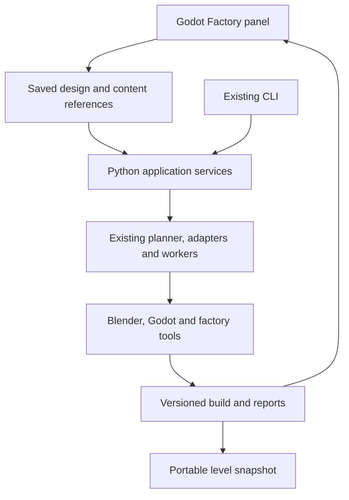

# Gabagool Factory: a plan for level authoring without AI

**Decision proposal • October 24, 2026 • Grounded in factory-v1.41.0 / Level Factory 0.227.0**

## 1. The goal and the recommended direction

Build a **Gabagool Factory panel inside Godot**. A designer chooses a starting template, shapes the location, generates alternatives, walks the result, makes visual changes, and exports the level. Blender remains the tool for creating or modifying reusable assets. The existing Python factory runs behind the interface.

The user should need **their imagination, Blender, Godot, and the installed Factory package**. They should not need a terminal, a Python installation they manage, hand-written JSON, generated scripts, an AI subscription, or a local language model for routine level creation.

The important engineering work is turning the decisions Claude currently makes into supported product behavior: explicit settings, compatible content choices, visible progress, recoverable errors, persistent edits, and clear acceptance evidence.

**Start with one complete creation loop using existing content.** Make Restaurant Row from a clean installation, change a supported setting, walk it, save it, reopen it, and export it without assistance. Then broaden the controls and content. A large interface over incomplete controls would hide the dependency rather than remove it.

This plan is a proposed implementation sequence. It does not claim the new panel or its contracts exist today. The companion [Claude and ChatGPT operating guide](Gabagool_Factory_01_Claude_ChatGPT_Operating_Guide.md) documents how to use the current package in the meantime.

## 2. What already exists, and what still needs work

This is not a proposal to rewrite ten tools. The package contains substantial generation and execution infrastructure.

| Area | Evidence in the uploaded package | What the next phase must provide |
|---|---|---|
| Installation | `factory.cmd`, `factory.sh`, setup/discovery, pinned dependency environment, doctor | A graphical first run with file pickers, exact fixes, and no terminal |
| End-to-end build | `cmd_make` imports, builds candidates, picks, approves, builds art, exports | A reviewable user flow with separate generate, choose, refine, and export actions |
| Desktop UI | Eight PySide6 screens in `apps/desktop/` | A complete new-project/new-level flow and a design-oriented interface |
| Application boundary | `FactoryService` already separates views from actions | Typed operations independent of CLI handlers; structured results and progress |
| Build execution | Scheduler, per-attempt logs, caching, fingerprints, cancellation token/process-tree termination | Wire these into reliable UI cancellation/recovery, including export/bake paths |
| Content | Building library, species/recipes, themes, dressing, lighting presets | A browsable compatibility-aware catalog with previews and supported combinations |
| Validation | Physical walk checks, normalized findings, locks, export closure, portability machinery | Plain-language issues, locations, recoveries, and accurate “not tested” states |
| Player preview | Export-based first-person walk | An obvious Play/Walk action and predictable handling of preview/export revisions |
| Authorship | JSON briefs and seeded generation | Visual editing, persistent design constraints, undo/redo, asset registration |
| Game integration | Dispatch exports shell intent and runtime requirements | A separately scoped adapter to the actual heist game's runtime |

### Specific gaps established by source inspection

**The desktop application is a starting point, not a finished level editor.** Its window wires Dashboard, Setup, Pipeline, Candidates, Art Pass, Validation, Job Console, and Handoff. There is no wired mission-brief editor or complete new-level wizard. Candidate cards have paths in the service model, but the current gallery displays a table rather than a visual layout editor.

**The action boundary needs work before becoming the product API.** `FactoryService._invoke` calls CLI implementations through a `SimpleNamespace` and captures global stdout/stderr. The Art Pass button calls the long-running service synchronously. That call path risks blocking the GUI until the work finishes; it is a code finding, not a measured GUI session. Reuse the operations, then invert the dependency so CLI and UI both call application services.

**Some designer-facing inputs have no generator behind them.** The code lists `route_shape`, `objective_hypotheses`, `extraction_relationship`, `verticality`, `landmark`, and `seed_policy` as recorded but unbuilt. Unknown brief keys are filtered at the model boundary. A field's presence in a file must not be treated as feature support.

**Warnings and automated choices need product semantics.** `make` records approvals automatically. The picker can return a candidate even when every candidate is “out.” The doctor can report required tools as unconfigured separately from its exit code. None of these should become an unqualified green “ready” badge.

**The preview and export are currently coupled.** `walk` re-exports; an unbaked preview option can change the shipped package. The new experience should keep preview builds and accepted exports distinct.

## 3. Define what “without AI” means

| User action | Product promise |
|---|---|
| Build a level from supported content | Fully possible through the interface |
| Choose a building type, arrangement, look, and supported lighting | Explicit controls with visible consequences |
| Change a generated level | Saved design decisions; regeneration preserves them or reports a conflict |
| Add a custom prop made in Blender | Register it through a guided asset workflow once that milestone ships |
| Invent an entirely new building system or mechanic | A new reusable capability is required; the product names the limitation |
| Describe anything in unrestricted prose | Store the idea for reference; do not imply the text executes without a language-understanding feature |

The generator can be deterministic while the work remains creative. Templates, a building palette, a site canvas, editable routes, look controls, and authored objects are ways to express imagination without asking a language model to translate it into code.

AI can remain an optional assistant for tool development or suggesting a draft. Every supported design operation must also be available without it. Any future AI integration must submit the same validated design data as the user interface; it must not become a privileged code-execution path.

## 4. The intended user experience

### A. First run

Open a provided Godot authoring project with the Factory plugin already enabled. Locate Blender and the factory package through file pickers if auto-discovery fails. A guided setup prepares the factory's private Python environment and runs checks.

Show actionable results such as “Blender found,” “Godot version supported,” “A package dependency is missing,” and “Light baking needs a display/GPU.” Provide the relevant setup action. Do not ask the designer to diagnose a Python traceback.

The current documented setup downloads dependencies once. Package an offline dependency set only after testing it on supported OS/Blender/Python combinations. “Works offline after setup” and “can install offline” are separate promises.

### B. New level

Choose an approved template with a thumbnail and concise description. Start with the packaged Restaurant Row request. Add bank and warehouse templates after their flows pass the same acceptance checks.

The first form asks only for choices that the current generator can deliver: name, supported building type, building count within the tested range, supported site/street arrangement, theme, time, weather, and variation count. Present human labels and units. Keep file IDs and CLI flags in an optional technical view.

Notes preserve the mission fantasy, such as “a tired Delco commercial strip after closing.” Beside the notes field, state that notes are for reference. Do not imply that prose causes asset creation.

### C. Choose a layout

Generate three alternatives by default. Show a top-down image, building identities, entrances, relevant route/clearance information, and validation state for each. Distinguish “valid,” “needs attention,” “failed,” and “not checked.” Explain what the automated ranking considered.

If all candidates fail the supported acceptance policy, show the failures and recovery actions. Never present the least-bad selection as a validated recommendation. Preserve advisory Laser Tag scores as advice rather than silently converting them into production combat requirements.

### D. Refine the level

The first release offers supported parameter changes and candidate selection. Later releases add direct placement, building locks, route controls, and asset placement through a site canvas and Godot viewport.

Useful designer actions include “keep this building,” “regenerate the other buildings,” “move the entrance,” “keep this alley clear,” and “change the materials without changing the layout.” Each action requires a corresponding generator/composer capability. Ship controls in the same increment as those capabilities.

### E. Walk and review

Click **Walk Level** to open the current preview. Show which saved revision and candidate it represents. Provide issue overlays for broken connections, colliding placements, and other spatial findings when their evidence supports a location.

After the walk, record a separate human assessment of readability, atmosphere, navigation, and combat space. Validation can show that routes work. It cannot establish that a heist is exciting or that a place feels lived in.

### F. Export

Choose a new export destination and see a compact checklist: package completeness, portability result, light-bake status, target renderer/profile, and unresolved findings. Export a snapshot of the selected revision. Subsequent preview work should not overwrite it.

The exported content opens without the authoring tools. For the real game, it meets the agreed integration contract. A walkable shell is the first deliverable; a functioning four-player mission depends on the game's runtime adapter.

## 5. Architecture: keep the factory, add a dependable front end

Use a Godot `EditorPlugin` for the designer-facing interface. Godot officially supports editor plugins built with GDScript and scenes; a custom dock can live beside the existing 3D editor. This avoids building and maintaining a second 3D viewport. Pin the implementation to the project's tested Godot release rather than blindly following changing `stable` documentation. [E1]

The optional PySide6 app can remain an expert diagnostic surface while the Godot workflow is developed. Do not fund two full authoring interfaces in parallel.

### A. Reuse the existing engine

Keep building generation in Deli Counter, site assembly in Lot, meshes/props in Zoo, materials in Pixelcoat, cohesion in Patina, lighting in Lux, and handoff in Dispatch. Preserve the current collision, functional-lock, and provenance contracts. Move orchestration logic out of CLI handlers only as needed to expose tested service operations.

A plausible home for the new client is `level_factory/apps/godot/addons/gabagool_factory/`; this is a proposed location, not an existing directory. The service boundary continues under `level_factory/packages/service/`. Ship a ready-to-open Godot authoring project that consumes the plugin.

### B. Start with a local process boundary

The Godot plugin launches the configured Python worker with an executable path and an argument array. A small request file identifies the operation and saved input revision. The worker produces a structured result plus append-only progress events. Keep ordinary log text separate from the event protocol.

A proposed v1 implementation can use UTF-8 JSON request/result files and JSON Lines events in a private run directory. That keeps startup and reconnection simple and avoids requiring a localhost server. Write results atomically. Version the protocol, reject unknown operations, and separate diagnostic errors from successful empty results.

Godot provides process-launch and pipe APIs, but blocking execution or reads on the editor thread would freeze the interface. Use nonblocking polling or an appropriate worker boundary and marshal UI updates back to the main thread. Verify the chosen APIs on the pinned release. [E2]

Python continues to own the Blender/Godot child processes, timeouts, and cancellation. The repository already has cancellation/process-tree support; wire it end to end and test export/bake subprocesses too. Cancelling a client window must not silently leave background generators running or mark a partial package complete.

### C. Proposed service operations

These are conceptual names for new or extracted operations, **not commands available today**.

| Operation | Required result |
|---|---|
| Discover installation | Executables, versions, supported/unsupported checks, fix actions |
| List capabilities | Current content options, constraints, dependencies, support status |
| Create/open/save design | Versioned design, stable ID, validation, migration result |
| Validate request | Field errors, unsupported intent, substitutions requiring a choice |
| Plan/build candidates | Job plan, build ID, progress, candidate evidence |
| Select candidate | Selected ID and evidence policy; no false human sign-off |
| Apply authored change | New design revision, affected work, conflicts |
| Build presentation | Art/light build tied to the selected shell and revision |
| Cancel/recover build | Verified stopped/resumable state and retained valid work |
| Open preview | Preview identity and matching build |
| Export package | Immutable snapshot identity, checks, bake state, destination |

The CLI and UI must call these same operations. A fix should not need separate implementations for Claude, the desktop app, and the Godot panel.

## 6. Make capabilities and schemas truthful

Build a capability catalog from the current models, supported enums, content registries, adapter contracts, and installation. Some UI metadata will be curated, but automated checks must catch drift between the catalog and runtime support.

For every exposed setting, record its label, type, range/options, default, owner, consumer, dependencies, impact on rebuilds, and support status. Add a proof showing that the setting reaches the intended stage or changes an appropriate measurable output. A UI control with no consumer is an unfinished feature.

Use these support states:

- **Supported:** implemented and verified for the declared combinations.
- **Conditional:** available only with named assets, theme, renderer, or configuration.
- **Intent only:** saved for review; does not change generation.
- **Unavailable:** no supported implementation.

Treat combinations as capabilities too. Rain and midnight should explain the current daylight-rain substitution before a build. Themes must be checked against the actual selected content; a theme existing somewhere is not proof every species supports it.

For persisted designs, use a standards-based schema and semantic validation backed by typed Python models. Centralize enum/range definitions. Maintain migrations for older projects and report unknown fields explicitly. The current descriptor and limited facade checks are useful starting material, not the finished contract.

JSON is sufficient for the first version and is easy to inspect across Python and GDScript. Keep serialization at the boundary so a future binary format or Protobuf transport would not change generation logic. Do not make that migration a dependency of the editor.

## 7. Preserve creative edits across regeneration

This is the most important capability after basic build reliability. If a user arranges a scene and regeneration erases their work, the product still needs an expert caretaker.

### Separate three kinds of state

| State | Examples | Rule |
|---|---|---|
| Authored source | Brief, building choices, placed assets, locked layout, asset references | Saved, versioned, portable, editable through the UI |
| Derived build | Generated scenes, meshes, nav data, caches, intermediate reports | Rebuildable; do not hand-edit as the source of truth |
| Accepted snapshot | Exported package and its evidence/manifest | Immutable revision; create a new snapshot for changes |

The current repo prohibits hand-patching generated workspace output. Preserve that rule while adding an explicit supported authoring layer. Update `USING_THE_FACTORY.md` and related policy when this ships: placing a reusable asset through the editor creates authored input; it is not a hidden downstream repair.

### Store intent using stable IDs

Use semantic entity IDs for buildings, entrances, routes, and authored props. Do not use transient node paths or instance indices as persistent edit targets. Store selections, transforms, locks, and exclusions in a versioned design document and pass them through the relevant generator/composer before validation.

Changing a seed must not silently move an authored choice to a different building. If a target disappears, display an explicit conflict: rebind, remove that authored change, or keep the earlier generation. Never silently drop it.

Generated collision changes must rerun the appropriate geometry/navigation gates and invalidate affected locks. Cosmetic changes should preserve the functional shell when the existing contracts permit it. Independently authored props still need declared collision/interaction behavior and validation.

### Make editing transactional

One user gesture creates one undoable design operation. Undo restores both the authoring data and the visible proxy state. Godot's `EditorUndoRedoManager` supports plugin undo/redo, but the plugin still has to connect that history to its saved design and build invalidation. It does not automatically preserve JSON files or running builds. [E3]

Build immutable input snapshots. A user editing revision 12 while revision 11 builds must see which result arrived. Keep generation under a designated generated subtree or staged preview project; refresh it after a successful build rather than modifying the user's open scene halfway through.

## 8. Let users grow the content library in Blender

Parameter controls will not cover every imaginative request. Provide two durable extension paths.

**Configure existing content.** Offer supported dimensions, materials, variants, arrangement rules, and reusable assemblies. Use the current Zoo and Deli Counter machinery where those controls already exist. Constraints should stop impossible combinations before a long build.

**Register an authored asset.** A future Blender panel or export preset lets the user select a collection, assign an asset ID/category, set a pivot, declare bounds/collision/attachment points, choose allowed scaling and materials, and generate a preview. Export meshes plus machine-readable metadata. Reuse the factory's existing axis, unit, slot, and collision conventions rather than introducing a parallel format.

Blender supports background execution of Python scripts and explicit Python-exception exit codes; a fixed exporter can run behind a UI action. The designer should not need to write or paste a script for each asset. [E4]

Start with non-interactive decorative props. Next support collidable props, then modular building pieces and assemblies. Doors, ladders, destructibles, and objective devices require stricter contracts and runtime ownership; do not treat them as ordinary decorative mesh imports.

A registered asset should be reusable in the next level without code changes. Validate dimensions, pivot, material count, texture dependencies, scale, collision declaration, and target-profile cost. Render a thumbnail and preserve author/source/license metadata when relevant to the asset.

## 9. Keep the level shell and the game runtime distinct

The no-AI editor can first deliver a walkable environment. For the user's four-player PvE heist game, another milestone binds authored mission intent to the game's already implemented systems.

Define a consumer adapter for player spawns, navigation contracts, enemy spawn/director hooks, interaction IDs/states, objectives, extraction, and ownership. Verify it with the actual player body and game controller, not only the factory's walker. Preserve Dispatch's declared runtime requirements.

Then test four-player sessions in the game: host authority, client interactions, late join if supported, synchronized objectives, blocked routes, and repeated scene transitions as applicable. The factory's four-bot scenario remains useful evidence about geometry; it does not replace these tests.

No-code mission assembly becomes practical when the game exposes reusable mission components. A designer can wire “take the item → reach extraction” through an editor only after those behaviors exist in the game runtime. New mechanics still need engineering.

## 10. Delivery sequence and exit criteria

Use gated increments rather than committing to a broad “editor complete” date. The estimates below are relative engineering size, not elapsed-time promises: **S** is focused work, **M** crosses several modules, **L** requires new contracts and engine validation. Re-estimate after the first vertical slice.

| Increment | Work and owner | Dependency | Exit evidence | Size |
|---|---|---|---|---|
| 0. Reliable assisted operation | Maintain the operating guide, measure interventions, resolve stale support documentation; factory docs + Level Factory | Current package | Another operator can reproduce the supported recipe and distinguish unbuilt intent without repo archaeology | S |
| 1. One graphical creation loop | Godot project/plugin, graphical setup, new level from Restaurant Row, supported form, asynchronous generate, choose, walk, save, export; Level Factory | 0 | New user completes the whole loop without terminal, JSON editing, or AI | L |
| 2. Trustworthy execution and recovery | Typed service extraction, capability/semantic validation, structured events, cancellation, restart recovery, snapshot export; Level Factory | Developed alongside 1 | Failures remain actionable; restart/cancel never reports a partial build as accepted | L |
| 3. Broader supported templates | Bank and warehouse flows, verified combinations, thumbnails and constraint-aware selection; Level Factory + relevant tools | 1–2 | Three independently tested template workflows; unsupported choices cannot masquerade as active controls | M |
| 4. Persistent visual authoring | Stable IDs, design revisions, locks, transforms, selective regeneration, undo/redo; Level Factory + Lot/DC/composer | 1–2 | User changes survive reopening and rebuilding; invalid edit targets become visible conflicts | L |
| 5. Reusable Blender content | Decorative asset import/registration, then collision/module contracts; Zoo + Deli Counter + Level Factory | Capability catalog; stable content references | A user makes a prop in Blender and uses it in two generated levels without a code change | M–L |
| 6. Actual heist integration | Runtime adapter and mission-component authoring; game runtime owner + Dispatch | Stable shell contract; game's systems | Four-player game tests establish playable mission behavior for the declared components | L |

**Minimum useful release:** increments 1 and 2, restricted to one supported template. It removes AI from routine operation but is not yet an unrestricted visual level editor. Increment 4 is what turns the interface into a tool for deliberate composition.

Do not postpone service reliability until after visual polish. Build the first UI and its service path together, then expand only after the creation loop works.

## 11. The first implementation backlog

Keep these as reviewable work items, each with observable acceptance.

| Priority | Work item | Acceptance |
|---|---|---|
| P0 | Capture a repeatable baseline | Fresh supported installation, source request, manifest, selected seed, logs and export evidence; failures remain in the denominator |
| P0 | Inventory setting support | Every first-release control has an owner, consumer, valid options, dependency rules, and a proof; unsupported fields are labeled |
| P0 | Extract the first service path | CLI and plugin use the same request validation/build operations; no UI scraping of phrases like `blockers open: 0` |
| P0 | Introduce structured run events | Build ID, revision, stage, status, progress where measurable, issue IDs, artifact references; logs retained separately |
| P0 | Deliver graphical setup/new level | User can choose paths, see required failures, save a request, and restart the authoring project without editing files |
| P0 | Generate/choose/walk/export | Restaurant Row works through the interface; results identify the correct revision; all-out results are clearly unsuccessful under the selected policy |
| P0 | Wire stop and reopen | Cancellation stops owned processes; reopening offers a valid recovery path or a clear restart; accepted exports survive |
| P1 | Add visual candidate comparison | Images and metrics come from the same candidate/build; missing images say missing rather than showing stale images |
| P1 | Add stable authored edits | One building/prop edit survives save, reopen, art rebuild, and seed-change conflict handling |
| P1 | Add first custom-asset workflow | An independently authored decorative Blender asset becomes catalog content and validates in two levels |

The first code milestone should end with a designer using the creation loop, not just a screenshot of a dock or a successful worker response.

## 12. Measure independence, quality, and cost separately

Keep the repository's interventions-per-level measure, but make its denominator honest. A build that stops is still an attempted build. Do not report only successful cold runs.

| Measure | Why it matters |
|---|---|
| Unsupported requests and substitutions | Shows the actual creative coverage rather than hiding demand |
| First-attempt completion / all supported attempts | Reveals reliability without cherry-picking seeds |
| Manual technical interventions per attempt | Counts terminal use, script edits, JSON repair, manual cache manipulation, generated-output patches |
| Planned creative edits | Tracks designer work separately from repairing the tool |
| Time to first walkable result | Captures installation and feedback cost |
| Incremental rebuild time by change type | Reveals whether routine iteration is practical |
| Cancel/restart recovery success | Determines whether long jobs are safe to use |
| Human quality review | Tests spatial readability, atmosphere, deliberate composition, and play experience |
| Runtime performance on target profiles | Prevents a responsive editor from shipping expensive levels |

Proposed pilot gate: **two people unfamiliar with the repository each complete three supported level tasks without AI, terminal use, or source edits**. They save/reopen, make a supported revision, walk, and export. Test cancellation and one realistic environment/content failure separately. Six tasks are a usability gate, not a statistically proven reliability rate; follow with a wider request/seed matrix.

Every issued setting needs a meaningful propagation test. Every persisted edit needs a round-trip/rebuild test. Every supported recovery action needs a forced-failure test. Reuse the existing tool tests; add GUI automation only for critical journeys and state transitions.

No silent gate removal is part of this plan. Present advisory findings clearly, keep structural blockers distinct, and label skipped/unavailable checks. Preserve the existing low-end renderer intent and measure real CPU/GPU frame time, draw calls, memory, and representative worst views. Do not promise FPS from a triangle count or a headless run.

## 13. Decisions to adopt now

1. **Godot is the primary authoring surface.** Keep the Python tools and shared services behind it.
2. **Support a complete narrow workflow first.** Begin with Restaurant Row; expand with evidence.
3. **Every control must have a real effect or an explicit intent-only label.** Do not build a form around the current brief schema blindly.
4. **Designer edits become saved source data.** Generated output remains rebuildable.
5. **Builds and exports identify their input revision.** Previewing cannot silently replace an accepted export.
6. **Grow reusable content through Blender and catalog registration.** Arbitrary new mechanics remain a separate engineering capability.
7. **A language model is optional.** The core creation loop must pass acceptance with no AI present.

## 14. Evidence and verification limits

The inspection exercised CLI help, workspace initialization, first-level batch import, graybox planning, parser forms, time-preset resolution, and an all-out picker case. The sample planned three candidates and twelve graybox jobs. Doctor correctly exposed missing tools/dependencies in this environment.

Blender, Godot, and PySide6 were unavailable here. No full level build, desktop interaction, visual review, GPU bake, frame-time measurement, or four-player game test was performed. Historical build claims in the package are the repository's records, not independently rerun results from this review.

Repository sources used for the proposal:

| Source, relative to factory root | Supports |
|---|---|
| `START_HERE.md`, `factory.cmd`, `factory.sh` | Existing installation and single-command path |
| `level_factory/apps/cli/main.py` | Current command surface, output layers, export/walk options |
| `level_factory/apps/cli/commands/__init__.py` | Make sequencing, automatic approvals, unsupported-field warning, input filtering, light preset mapping, preview/export coupling |
| `level_factory/packages/core/models.py` | Actual request fields and generation limitations |
| `level_factory/packages/pipeline/pick.py` | Candidate ranking and all-out fallback |
| `level_factory/apps/desktop/windows/main_window.py`, `views/screens.py` | Eight screens, missing wired authoring flow, synchronous action call path |
| `level_factory/packages/service/facade.py` | Existing service models, limited brief checks, CLI-handler dependency |
| `level_factory/packages/jobs/runner.py`, `scheduler.py` | Process execution, cancellation infrastructure, orchestration reuse |
| `level_factory/schemas/mission.brief.schema.json` | Existing lightweight schema descriptor |
| `PIPELINE_MAP.md`, `USING_THE_FACTORY.md`, `CLAUDE.md` | Tool ownership, generated-output policy, runtime boundaries, intervention metric |

External implementation references, checked October 24, 2026:

- **[E1] Godot: Making plugins.** Supports the editor-plugin/dock approach. [Official documentation](https://docs.godotengine.org/en/stable/tutorials/plugins/editor/making_plugins.html).
- **[E2] Godot: OS.** Process creation and pipe APIs; implementation must avoid blocking editor-thread work. [Official API reference](https://docs.godotengine.org/en/stable/classes/class_os.html).
- **[E3] Godot: EditorUndoRedoManager.** Plugin integration with editor undo histories. [Official API reference](https://docs.godotengine.org/en/stable/classes/class_editorundoredomanager.html).
- **[E4] Blender: Command Line Arguments.** Background operation, Python execution, and Python exception exit-code handling. [Official manual](https://docs.blender.org/manual/en/latest/advanced/command_line/arguments.html).

The architecture, proposed operations, milestones, acceptance targets, and effort sizes are recommendations derived from this inspection. They are not claims made by the external documentation or features already implemented in the uploaded package.
