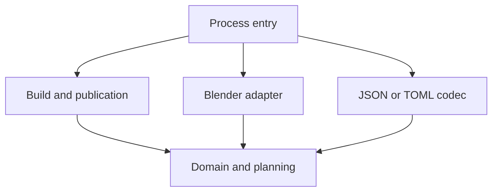

# Python Best Practices for a Blender–Godot Toolchain

**Working standard, reference implementation, and research notes**  
Revision 3 · October 24, 2026 · Python 3.11+ example · Godot 4 API style

Use this guide when Python generates assets in Blender and GDScript consumes them in Godot. It covers organization, documentation in source, validated data structures, ownership, repeatable builds, and a future Protobuf boundary. It is a proposed project standard, not an audit of an existing repository.

The companion **Python_Blender_Godot_Reference_Kit.zip** contains the files named below. Unzip it and start with `README.md`. This guide is also included as `GUIDE.md`. File paths in this document are relative to that kit.

**Validation status:** the Python core and property checks ran successfully. Blender, Godot, `protoc`, and the external JSON Schema validator were unavailable. Engine integration and schema-validator execution are supplied as explicit, currently unpassed gates. See Section 10 and the kit's `VALIDATION.md`. No end-to-end engine certification is claimed.

Primary reference: [Blender Python API documentation](https://docs.blender.org/api/current/index.html), supplied for this guide. Select documentation matching the installed engine before qualifying an adapter. A moving `current` or `stable` URL does not pin a toolchain.

## 1. The working standard — read this first

**Keep the rules for what to build separate from the engine that builds it and the format that carries it.** A Python planner should calculate a wall without opening Blender. An adapter creates Blender geometry. A contract transports meaning. Godot owns the resulting runtime nodes.

For reusable tools, these are requirements. The gate column names an automated check where one exists; manual review remains necessary.

| ID | Requirement | Evidence / gate |
|---|---|---|
| **PY01** | Core models and planners import without `bpy`, `bmesh`, or engine state. | `core`: import check and direct dependency guard; review indirect dependencies. |
| **DATA01** | External data has a named version, explicit units and validated values. | `core`, `schemas`, `godot`: shared semantic fixtures. |
| **DOC01** | Public operations state inputs, effects, ownership and failure behavior. | Manual review against the source contract template in Section 5. |
| **OWN01** | Create, modify and free only resources the operation owns. | `core`, `blender`; inspect cleanup paths and Godot caller ownership. |
| **BUILD01** | Failure before publication leaves the last published revision usable. | `core`: export, validation, checkpoint and commit failure tests. |
| **COORD01** | Convert axes once; verify an asymmetric asset after import. | `godot`: actual mesh bounds, not just copied metadata. |
| **CHANGE01** | Encoding and material changes do not rewrite the planner. | `core`, `properties`: substitution and value-preservation checks. |
| **REPO01** | Keep one canonical implementation; separate source, experiments and generated output. | File inventory, diff review and the Section 12 checklist. |
| **ENV01** | Qualify the exact engine builds before declaring the pipeline ready. | `blender`, `godot`, plus `QUALIFICATION.md` review. |

**Normal edit loop:** change the smallest owning module → run its gate → inspect the generated result if engine behavior changed → update the contract or decision record when meaning changed.

**Exception rule:** record the rule ID, reason, owner, compensating check and revisit condition in a short decision record. A quick experiment may use fewer layers; an exception does not silently become the production standard.

**Release rule:** a missing dependency is a blocked gate. Unit tests using a fake exporter do not qualify Blender or Godot. Formatting, test coverage percentages and docstring counts do not demonstrate correct ownership or compatibility.

`standards.json` repeats the rule IDs for review automation. It is a traceable checklist, not an automatic verifier of every sentence above.

## 2. Use only as much architecture as the work needs

| Stage | Appropriate structure | When to expand |
|---|---|---|
| Disposable experiment | One script with explicit parameters, small functions, a clear output directory and a short usage note. | Someone repeats it, shares it, or relies on its output. |
| Reusable Blender tool | A package; validated inputs; pure planning; one Blender adapter; documented ownership; tests for important behavior. | Another consumer or language needs the data; release failures become costly. |
| Shared asset pipeline | Versioned contracts, shared fixtures, atomic publication, pinned environments, compatibility gates, migration decisions. | Multiple teams, release cadences or measured performance requirements justify more infrastructure. |

Do not begin with a plugin registry, generic repository layer, dependency-injection framework, or a base class for every object. The reference kit has one package and two small protocols where replacement is concrete: a codec and a mesh exporter.

A good boundary hides a decision likely to change. Here those decisions are geometry construction, engine APIs, material lookup, representation, publication and runtime assembly. This is an application of Parnas's information-hiding argument [R2], not a claim that his paper prescribes this folder layout.

## 3. Organize by responsibility and dependency direction

| File or directory | Owns | Must not own |
|---|---|---|
| `src/wall_factory/domain.py` | `WallSpec`, identifiers, numeric invariants | Blender data blocks, files or scene nodes |
| `planning.py` | Vertices, face winding, dimensional planning | Selection, active object, disk access |
| `contracts.py` | JSON/TOML parsing and explicit wire-to-domain mapping | Mesh creation or gameplay behavior |
| `materials.py` | Stable material ID lookup | Geometry rules |
| `publication.py` | One build operation, exporter port, staging and commit | Blender-specific API calls |
| `adapters/blender.py` | Temporary scene, mesh and material creation; GLB export; cleanup | Contract parsing or Godot behavior |
| `tools/blender_build.py` | Process arguments and dependency assembly | Reusable planning rules |
| `contracts/` | Schemas, fixtures, proposed `.proto` | Engine object graphs |
| `godot/wall_data.gd` | Typed, validated values | Nodes or loaded resources |
| `godot/wall_loader.gd` | Boundary validation and scene construction | Python algorithm reimplementation |
| `tests/`, `godot/tests/` | Observable behavior and failure checks | Production branching to make tests pass |

`publication.py` combines use-case coordination and filesystem work to keep this example small. Split those responsibilities when there are multiple publication backends or independent owners; the filename is not a commitment to a framework.

Arrows below mean “depends on.”



The build operation receives an exporter callable. It does not import the concrete Blender adapter. Godot lives on the other side of the published file contract, not inside the Python import graph.

Keep package imports lightweight. Avoid generating geometry, loading files, registering Blender classes or reading environment variables as an import side effect. Pass configuration into the operation that needs it.

Prefer names such as `mesh_validation.py`, `material_catalog.py` and `asset_paths.py` over a growing `utils.py`. Keep a specific utility when it has a specific responsibility. File count alone is not an architecture quality metric.

The kit uses a `src/` package layout. Its check runner supplies an explicit test import path, and its Blender process entry adds the known `src` directory once. In a deployed tool, package installation is generally easier to maintain than scattered `sys.path` edits. See [PyPA's layout explanation](https://packaging.python.org/en/latest/discussions/src-layout-vs-flat-layout/).

## 4. Follow one wall from recipe to Godot

The example deliberately uses an asymmetric wall: **2.4 m wide, 2.8 m high, 0.18 m thick**. Unequal dimensions make an axis swap visible.

```json
{
  "contract": "factory.wall_spec",
  "version": 1,
  "wall": {
    "asset_id": "wall_a",
    "width_m": 2.4,
    "height_m": 2.8,
    "thickness_m": 0.18,
    "material_id": "plaster"
  }
}
```

The complete flow is implemented in the kit:

1. **Parse and validate.** The codec bounds payload size, reads the encoding and constructs `WallSpec`. Values must be finite numbers, not booleans or numeric strings. Identifiers use a small ASCII grammar. All fields are required; unknown fields are rejected.
2. **Plan.** `plan_wall(spec)` returns immutable vertex and face tuples. The wall spans Blender X = width, Y = thickness, Z = height. It has eight vertices and six outward-wound faces.
3. **Create and export.** The Blender adapter creates its own temporary scene, mesh, object and material. It exports only that scene to GLB with Y-up conversion enabled, then removes those temporary data blocks in `finally`.
4. **Publish.** A build writes to its own staging directory, checks the GLB header, computes hashes and writes metadata. A complete revision moves into `bundles/<revision>/`. Replacing `current.json` is the commit point.
5. **Consume.** Godot validates the pointer and manifest, checks hashes, validates the embedded specification, imports the GLB, assigns identity metadata and adds a box collision shape.
6. **Verify and release ownership.** The Godot test compares actual imported mesh bounds with expected bounds. The caller frees the returned node when it is finished with it.

This is a complete reference implementation to run and qualify, not a claim that its engine integration has already passed.

### What each artifact means

| Artifact | Responsibility |
|---|---|
| Input `wall.json` or equivalent TOML | Author's requested dimensions and stable identity |
| `wall.glb` | Geometry and visual material |
| Published `spec.json` | Normalized recipe for inspection and reproduction |
| `manifest.json` | Authoritative runtime metadata, embedded recipe, bounds, mesh hash, producer versions |
| `current.json` | Revision selection and manifest hash |

Godot reads the embedded recipe in the manifest. The separate `spec.json` is for inspection and reproduction; it is not a second competing runtime authority.

Do not use Protobuf as a replacement for GLB mesh interchange. It is a candidate representation for recipes, metadata or messages.

### Spatial agreement

Blender authoring coordinates `(x, y, z)` become Godot `(x, z, -y)` through the exporter's glTF Y-up conversion. This example therefore expects:

- Minimum corner: `(0, 0, -0.18)`.
- Size: `(2.4, 2.8, 0.18)`.
- Collision center: half the size added to the minimum corner.

Do not apply the same conversion again in GDScript. Test actual imported geometry and transforms. Metadata that agrees with itself can still describe a wrongly rotated mesh.

For more complex assets, specify forward direction, handedness, local versus world space, origins, transform order, normals, scale application and animation conventions. Add a marked asymmetric asset to catch orientation errors beyond a rectangular box.

## 5. Make the source explain the contract

Use meaningful names and types first. Add documentation for behavior that names and types cannot express.

| Put here | Information |
|---|---|
| Names | Role, quantity and units: `width_m`, `asset_id`, `output_root` |
| Type annotations | Expected shapes and relationships; narrow `object`/`Variant` after validation |
| Docstrings / GDScript `##` | Purpose, units, invariants, side effects, ownership, errors and return meaning |
| Inline comments | Why a surprising choice exists; engine limitations or compatibility reasons |
| README | Installation, one working command, checks and troubleshooting |
| Decision record | A consequential tradeoff and the condition for revisiting it |
| Tests | Observable examples, rejection cases and failure guarantees |

A useful source contract looks like this:

```python
def build_bundle(spec, root, export, *, checkpoint=...):
    """Publish one complete revision.

    Requires an initialized output root on one local filesystem.
    Owns its staging directory; previous revisions remain untouched.
    A failure before the pointer commit preserves the current revision.
    Returns the completed revision directory after a successful commit.
    """
```

The actual implementation includes type annotations. The shortened example emphasizes behavior: each claim has a corresponding review or test target.

Write “the caller owns and must free the returned node” rather than “returns a node.” Write “meters along local X” rather than “width.” Document that an exception can leave a completed but unpublished revision rather than promising a general rollback that the code cannot provide.

Avoid comments that narrate syntax. A comment explaining why `bool` is rejected as a measurement is useful because Python treats it as an `int` subclass. A comment saying “set width” above `width = value` is not.

For GDScript, use `##` documentation comments on public classes, properties and methods. Keep a class's meaning close to its declaration. Follow the official [GDScript style guide](https://docs.godotengine.org/en/stable/tutorials/scripting/gdscript/gdscript_styleguide.html) and [documentation comments guidance](https://docs.godotengine.org/en/stable/tutorials/scripting/gdscript/gdscript_documentation_comments.html).

### Types and structures

Use a frozen, keyword-only dataclass for validated domain values. Freezing prevents field reassignment; it does not recursively freeze mutable objects. The kit's geometry plan therefore uses tuples rather than lists.

Use plain functions for stateless transformations. Use a class when it owns state, enforces a value invariant, or represents a replaceable capability. Avoid inheritance where composition or one callable is sufficient.

Annotations are not runtime validation. `WallSpec(width_m="2")` still needs to be rejected by the model or boundary. A `TypedDict` can help a checker understand a parsed dictionary, but it does not turn untrusted input into validated data.

Run a chosen type checker in a real project, qualify Blender stubs against the installed release, and scope suppressions narrowly. The kit does not claim a completed mypy/Pyright run. Research [R4–R6] supports treating annotations as maintained engineering information, not measuring quality by annotation volume.

## 6. Refactor a script without losing its behavior

A typical starting point combines scene discovery, parsing, geometry, export and output naming:

```python
# Illustrative fragment of an existing script; not an instruction to run it.
def make_wall(settings):
    width = float(settings["width"])
    height = float(settings["height"])
    thickness = float(settings["thickness"])
    bpy.ops.mesh.primitive_cube_add()
    obj = bpy.context.active_object
    obj.dimensions = (width, thickness, height)
    bpy.ops.export_scene.gltf(filepath=settings["output"])
```

The problem is observable uncertainty: which scene is exported, whether selection matters, what the origin means, which other objects survive, and what happens on failure. Merely splitting this function into five files preserves those uncertainties.

Refactor in this order:

1. **Capture intended behavior.** Save a small recipe and inspect the resulting asset: dimensions, origin, orientation, identity, material and collision. Record which current behaviors are accidental. Do not promise byte-identical GLB output across exporter versions.
2. **Extract validation.** Map legacy keys into a validated `WallSpec`. Keep coercion in a temporary migration adapter if existing callers require it; the new public contract rejects numeric strings.
3. **Extract planning.** Make geometry a function of the specification. Assert dimensions and winding without Blender.
4. **Isolate Blender work.** Pass a plan and explicit target path to an adapter. Give the adapter a documented resource owner and cleanup scope.
5. **Isolate publication.** Build into staging and commit only a complete bundle. Exercise failure before replacing the pointer.
6. **Prove the resulting asset.** Compare actual Godot geometry and material behavior with the recorded expectation. Remove the legacy path after compatibility requirements pass.

The resulting call sites are small because the contracts carry meaning:

```python
codec = JsonWallCodec()
spec = codec.decode(input_path.read_bytes())
revision = build_bundle(spec, output_root, export_wall)
```

The example assumes `output_root` was explicitly initialized. `build_bundle` calls the pure planner and passes its result to `export_wall`; the caller does not need Blender selection state.

**Behavior preservation has a boundary.** This kit's lower-corner origin and strict validation are deliberate new contract choices. A legacy centered cube requires an explicit origin migration or a compatible planner. Rejecting previously accepted strings is also a behavior change. Label these decisions rather than hiding them inside a cleanup PR.

## 7. Blender hygiene that affects correctness

Use the [API Overview](https://docs.blender.org/api/current/info_overview.html), [Best Practice](https://docs.blender.org/api/current/info_best_practice.html) and [Gotchas](https://docs.blender.org/api/current/info_gotcha.html) with the reference for each called API.

**Prefer the data API for explicit data changes.** `bpy.data.meshes.new`, `mesh.from_pydata` and collection linking make ownership visible. An operator can be appropriate for an export operation; specify its context and options and inspect its return value. Do not assume an operator works in every mode, editor or background context.

**Keep add-on UI thin.** A panel or operator should gather input, invoke the use case and report the outcome. Registration and unregistration must pair classes, handlers, timers and properties. The kit is a process script, so it does not claim to test add-on lifecycle behavior.

**Record created resources.** The adapter retains direct references to the scene, object, mesh and material it creates. It removes those references explicitly. It does not delete by a shared display name or clear the user's scene. For persistent generated collections, use stable owner IDs and a deliberate replacement policy.

**Respect evaluated-data lifetimes.** When working with evaluated objects and temporary meshes, follow the relevant API cleanup method and do not retain pointers across operations that invalidate them. Copy plain values into your domain model. Never serialize live `bpy` objects as your contract.

**Keep Blender API work on its supported execution path.** Do not call Blender APIs from background Python worker threads. Isolate CPU-heavy pure computations or jobs in separate processes where appropriate; pass plain data and keep engine mutation in the engine process. See the official [threading gotcha](https://docs.blender.org/api/current/info_gotchas_threading.html).

**Qualify failures as well as success.** The kit's Blender gate checks allocation counts after successful A-B-A builds. Production qualification still needs an injected exporter failure to verify engine cleanup, plus real scene/material variations. Python publication tests cannot substitute for those engine checks.

## 8. Contracts and GDScript should preserve meaning

The actual schemas are `contracts/wall_spec.schema.json`, `bundle.schema.json` and `pointer.schema.json`. They use JSON Schema Draft 2020-12. Python and GDScript also perform semantic validation because schema shape alone cannot prove relationships such as “bounds agree with dimensions.”

This v1 contract makes explicit choices:

| Topic | Policy |
|---|---|
| Dimensions | Finite numeric values in meters; minimum 0.001 m; width/height at most 200 m; thickness at most 2 m |
| Identity | ASCII lowercase letter followed by lowercase letters, digits or underscores; at most 64 characters |
| Presence | Every declared field required; missing and null are invalid |
| Unknown fields | Rejected for this small, tightly coordinated contract |
| Versions | Only integral value 1 accepted; boolean `true` is not version 1 |
| Input size | Recipe JSON/TOML at most 16 KiB |
| Mesh size | Godot loader at most 1 MiB for this example |
| Paths | Fixed filenames and a validated hexadecimal revision ID; no wire-controlled arbitrary paths |
| Numbers across languages | These bounded dimensions avoid large-integer interchange issues; future counters/IDs need their own policy |

Strict unknown-field rejection makes accidental misspellings visible, but additive changes can break old readers. If independently deployed readers become a requirement, deliberately revise that policy, add compatibility fixtures, and document unknown-field preservation or rejection. Protobuf's ability to carry unknown fields does not retroactively make this JSON policy forward compatible.

### Parsing is not validation

Godot's official [JSON reference](https://docs.godotengine.org/en/stable/classes/class_json.html) documents permissive parsing behavior, including acceptance of trailing commas and some malformed Unicode. The kit therefore distinguishes:

- **Producer syntax tests:** strict UTF-8, duplicate-key rejection, non-finite JSON constants, trailing commas and payload size.
- **Shared semantic fixtures:** versions, fields, identifiers, ranges, nulls and booleans, after parsing.

The shared fixtures do not establish identical JSON grammars. This loader consumes trusted, normalized build output. For untrusted input, choose and qualify a strict parsing boundary separately. SHA-256 checksums detect inconsistent bytes; they do not authenticate an author or make hostile GLB content safe.

### Keep runtime responsibilities separate

`wall_data.gd` holds values. `wall_loader.gd` creates an in-memory scene through [GLTFDocument](https://docs.godotengine.org/en/stable/classes/class_gltfdocument.html), attaches stable identity and creates collision. Gameplay scripts should receive the resulting scene or data rather than reparsing files.

For an editor workflow, adapt this boundary into an importer, assign scene owners before packing, and verify reimport. For repeated runtime spawning, use imported resources and instances. Avoid parsing a GLB every frame or rebuilding immutable geometry for each object. A `MultiMesh` optimization changes rendering organization; it should not force a new recipe format unless the data's meaning changes.

## 9. Make Protobuf adoption a bounded change

The useful abstraction is **bytes ↔ validated domain values**, not “everything inherits from a serializer.” The kit's `WallCodec` protocol has `encode(spec) -> bytes` and `decode(data) -> WallSpec`. JSON and TOML implement it, and tests show that both preserve the same specification and mesh plan.

TOML here is a concrete second implementation proving the seam. It does not prove that a Protobuf integration is complete. Bundle metadata remains JSON, so changing the authoring input codec currently leaves the Godot reader unchanged.

The proposed `contracts/wall_spec.proto` uses explicit field presence for scalars. A future adapter must check required presence, reject invalid values, and construct the same `WallSpec`. Generated messages belong at the boundary, not throughout planning or gameplay code.

### Adoption sequence

1. Identify a measured reason: multiple maintained consumers, binary message needs, or costly schema/code synchronization. A folder cleanup alone is not a reason to adopt Protobuf.
2. Decide the boundary: authoring recipe, published metadata, network messages, or more than one. These are separate decisions.
3. Pin the compiler, language runtime and any generator/plugin. Compile the schema and retain generation instructions. Do not hand-edit generated files.
4. Write explicit message-to-domain mapping and presence checks. Reuse the domain invariant tests and shared semantic cases.
5. Test old-reader/new-writer and new-reader/old-writer combinations. Decide unknown-field behavior, enum policy and rollback before rollout.
6. Switch one boundary behind the codec port. Compare domain values and geometry, not raw serialized bytes.

The official Protobuf supported-language material does not provide a built-in GDScript generator. Possible integration routes include a qualified third-party plugin, a C#/native bridge, or build-time conversion to the established Godot-facing contract. Choose a route only after checking maintenance, target-platform support and build cost. See [official language support](https://protobuf.dev/overview/) and [third-party add-ons](https://protobuf.dev/reference/other/).

Follow [Protobuf schema-evolution practices](https://protobuf.dev/best-practices/dos-donts/): never reuse removed tag numbers, reserve removed fields appropriately, and avoid casually changing field types. Field numbers are wire identities; Python property names are not. Generated defaults do not establish business validity. [ProtoJSON](https://protobuf.dev/programming-guides/json/) is also a specific mapping, not interchangeable with an arbitrary existing JSON document. Deterministic serialization should not be treated as a universal canonical content hash.

### Change exercises that test the structure

| Change | Files expected to change | Evidence | Status in kit |
|---|---|---|---|
| Read TOML instead of JSON | Codec selection at the entry point | Both codecs produce the same `WallSpec` and plan | Implemented; Python checks pass |
| Change the color assigned to `plaster` | Material catalog/adapter data | Planner vertices and faces unchanged | Lookup/substitution check passes; visual result needs Blender/Godot |
| Use a different box mesher | Planner or mesh adapter, depending on responsibility | Same dimensions, winding, import bounds, material behavior | Exercise; not implemented |
| Add a Protobuf input codec | Schema, generated code, codec and entry wiring | Same domain values, compatibility matrix | Schema sketch only; not compiled |
| Replace Godot import with a cached-resource path | Godot import/assembly boundary | Same identity, geometry and collision | Exercise; not implemented |

If changing the input encoding requires edits to geometry rules, the boundary is leaking. If changing a geometry algorithm requires broad changes to gameplay code, inspect which engine details escaped into the contract.

## 10. Run checks, and describe what they actually prove

From the extracted kit root:

```sh
python tools/check.py core
python tools/check.py properties
python tools/check.py schemas
python tools/check.py blender --blender /absolute/path/to/blender
python tools/check.py godot --godot /absolute/path/to/godot
```

The core is standard-library-only. Property and schema gates require the development dependencies from `pyproject.toml`; setup is in `README.md`. `python tools/check.py all` runs the gates sequentially and fails when a required tool is missing. Run Blender before Godot because Godot needs the produced bundle.

| Layer | Preparation result | What it establishes |
|---|---|---|
| Python unit/integration checks | **21 tests passed**, including 26 semantic fixtures | Validation, planning, outward winding, encoding substitution, basic dependency checks and publication failure behavior |
| Hypothesis properties | **2 tests passed**, 300 generated examples configured per property | Codec round trips and mesh extents over generated bounded dimensions; not exhaustive proof |
| JSON Schema engine | **Blocked: `jsonschema` unavailable** | Actual schemas and a validator command are supplied; schema-engine execution remains pending |
| Blender | **Blocked: binary unavailable** | Temporary ownership, GLB export and A-B-A engine execution require a real run |
| Godot | **Blocked: binary unavailable** | GDScript compilation, fixture agreement, imported geometry and collision require a real run |
| Protobuf | **Not run: compiler/runtime unavailable** | Proposed schema has not been compiled; no working Godot Protobuf path is claimed |
| Static typing | **Not run** | Type annotations are supplied; no checker-clean certification is claimed |

Python tests use a deliberately minimal, header-valid fake GLB for publication checks. It is **not** a valid renderable mesh. This prevents a publication unit test from being mistaken for an asset-import test.

The AST import guard catches direct forbidden imports. It does not prove the absence of every possible indirect dependency or dynamic import. Review the dependency direction as well as running the guard.

### Failure and reproducibility checks

The kit exercises failures after export, after verification, immediately before commit, and during the pointer replacement. Each leaves the previous pointer unchanged. It also checks a second writer cannot take over an existing lock and that an unowned nonempty output directory is not adopted.

The publication guarantee is intentionally narrow: one controlled output root, one writer, one local filesystem, atomic visibility of a pointer replacement. It is not a power-loss durability guarantee, distributed transaction or rollback of arbitrary scene modifications. Old revisions remain for rollback. Completed but unpublished revisions can remain after a failed commit.

For engine qualification, compare A generated in a fresh process with A after B in a reused process. Check semantic outputs, resource counts and ownership, not only metadata or one byte hash. The supplied Blender A-B-A runner checks resource counts and repeated normalized recipes; the Godot gate checks the final imported A. Fresh-versus-reused full semantic comparison and injected Blender cleanup failures remain explicit qualification tasks.

Capture exact Blender build, embedded Python, Godot build, OS and gate logs in `QUALIFICATION.md`. The kit currently leaves engine versions pending rather than inventing a pin. In the adopted project, commit exact versions and enforce them in CI before release.

## 11. Review a change with five questions

1. **Can a new reader locate the owning module?** The filename and public contract should explain the responsibility without reading every caller.
2. **Can the input be rejected before it causes effects?** Verify required fields, units, ranges and ownership before changing scene or disk state.
3. **Is each failure guarantee backed by a test at the relevant layer?** A fake exporter cannot demonstrate Blender cleanup.
4. **Does the intended change stay local?** Use the change exercises, not just a tidy directory tree, to assess abstraction.
5. **Can another person run one complete example from a clean environment?** Verify the setup, pin record, expected outputs and failure messages.

Start adoption with one representative generator. Capture its behavior, extract a pure planner, define its contract and complete its engine qualification. Apply the structure to other generators after that example exposes the practical costs. Keep research and longer rationale available below, while daily work starts with Section 1.

## 12. Keep the Python repository understandable

Repo hygiene means a reader can tell which files are supported, how they run, and which outputs can be regenerated. A clean directory tree with duplicate or unreachable implementations is still difficult to maintain.

### Give every Python file a clear home

| Kind of file | Home and rule |
|---|---|
| Reusable production code | `src/<package>/`; one canonical implementation of each responsibility |
| Command entry point | Installed entry point or `tools/`; thin `main()` function with an execution guard |
| Blender adapter / add-on entry | Named adapter or add-on package; explicit registration and cleanup |
| Tests | `tests/` or engine-specific tests; named for behavior and dependency cost |
| One-off experiment | Clearly labeled `experiments/` outside the supported package; owner and promotion/removal condition |
| Generated Python, such as Protobuf output | Separate generated location with provenance and regeneration command; no manual edits |
| Old implementation | Remove after migrating callers; recover historical versions from Git |

Before adding a module, search for the behavior and its call sites. Avoid `generator_final.py`, `generator_v2.py`, `generator_fixed.py`, and copied backups. Actual versioned public contracts may need parallel readers; temporary uncertainty about which implementation works does not.

Follow [PEP 8 module naming](https://peps.python.org/pep-0008/#package-and-module-names): choose lowercase snake_case names and avoid shadowing libraries with files such as `json.py`, `typing.py`, `pathlib.py`, or `bpy.py`. Keep a consistent package import strategy. A module working only when launched from one particular directory is a setup defect, not a reason to add more path mutations.

A standalone command should place execution behind `if __name__ == "__main__": main()`. Importing it should not start a build. Keep reusable logic out of command parsing, and keep catch-all helper modules from becoming the hidden center of the project.

### Separate authored inputs, source and generated output

Track source, schemas, small test fixtures, `pyproject.toml`, the adopted environment lock, contributor instructions and decision records. Track generated source only when your build/distribution policy calls for it; identify the generator and regeneration command. Never hand-edit generated Protobuf modules.

Ignore `__pycache__/`, bytecode, local virtual environments, tool caches and disposable `build/` or `dist/` output. The kit includes a concrete `.gitignore`. Adding a rule does not remove files already tracked by Git.

Do not broadly ignore `*.json`, `*.glb`, `*.blend`, `*.uid`, or the entire `scripts/` directory. These can contain real inputs and required source identity. Authored Blender assets need an explicit binary/LFS policy, while generated revisions have a separate retention policy. Godot's `.godot/` cache and source `.gd.uid` files serve different purposes; see the official [UID workflow guidance](https://godotengine.org/article/uid-changes-coming-to-godot-4-4/). Move a script's UID alongside it when renaming outside the editor.

Keep dependencies and tool configuration discoverable through `pyproject.toml`. Avoid several competing requirements files with no declared source of truth. For a toolchain application, commit the chosen resolver's environment lock and recreate environments from it. This kit's direct dependency pins are not a full transitive lock.

### Retire scripts by checking their consumers

Search imports, command invocations, package entry points, CI, tests, documentation, Blender registration and handlers, external launchers, and downstream tools. Static unused-code reports cannot see every string-based callback or add-on hook.

Migrate callers and delete the redundant implementation in the same reviewed change when practical. If a public command needs a compatibility wrapper, keep it small and give it an owner and removal condition. Avoid turning `old/`, `backup/` or `archive/` into a second undocumented codebase.

After renaming a module, update its imports, launch commands and documentation, then exercise the supported invocation. Preserve behavior fixtures when the retired script is the only record of an important edge case.

### A small maintenance check

```sh
git status --short --untracked-files=all
git diff --check
git ls-files '*.py'
git ls-files -ci --exclude-standard
python tools/check.py core
```

Review the tracked Python inventory for a clear responsibility and a known consumer. The fourth command reveals tracked files that match ignore rules. Remove only identified unwanted artifacts from the index; avoid bulk wildcard cleanup.

Before a handoff, check for duplicate entry points, absolute developer paths, unexplained `sys.path` edits, import cycles, stray debugging output, swallowed exceptions, credentials and large generated fixtures. Keep useful operational logging. Run a clean-checkout setup occasionally so a developer's local environment cannot hide missing files or dependencies.

Put the supported entry commands, allowed dependency direction, generated directories and required checks in short contributor instructions. An `AGENTS.md` can point coding agents to the same rules; it should not become a competing architecture document.

The companion `REPOSITORY_HYGIENE.md` is the shorter, reusable checklist for file creation, commits and script retirement. These are proposed practices; no existing factory repository was inspected or cleaned as part of this document revision.

## Appendix — Research evidence and PDF reading list


This is a focused reading set, not a systematic literature review. Papers were selected for direct relevance to Python practices or to architectural decisions in this toolchain. Primary papers, author-hosted copies, and university repositories take precedence over summaries. Publication dates come from the papers or venue records, not search-engine crawl dates.

**Evidence labels:** an empirical study observes a particular population; a thesis is graduate research with its own scope and examination process; a software paper describes a research tool; and a foundational design paper argues for a design principle. None independently validates this complete Blender–Godot architecture.

### R1. Scientific scripting discipline

**Greg Wilson et al. (2014), _Best Practices for Scientific Computing_. PLOS Biology 12(1), e1001745.**

[Publisher PDF](https://journals.plos.org/plosbiology/article/file?id=10.1371/journal.pbio.1001745&type=printable) · [Publication / DOI](https://doi.org/10.1371/journal.pbio.1001745)

- **Evidence:** research- and experience-informed practice guidance, not a controlled trial of a Python architecture.
- **Useful contribution:** coordinated practices for understandable code, automated workflows, provenance, testing, and documentation of intent.
- **Applied here:** keep the build command reproducible and connect behavioral documentation to checks.
- **Limit:** language-general scientific computing guidance. Blender-specific ownership and API rules still come from engine documentation.
- **Read:** Box 1; sections on documenting design/purpose and recording provenance.

### R2. Module boundaries and future abstraction

**David L. Parnas (1972), _On the Criteria To Be Used in Decomposing Systems into Modules_. Communications of the ACM 15(12), 1053–1058.**

[University-hosted PDF](https://www.cs.tufts.edu/comp/150FP/archive/david-parnas/criteria.pdf) · [DOI](https://doi.org/10.1145/361598.361623)

- **Evidence:** foundational design argument using alternative decompositions of an example system.
- **Useful contribution:** organize modules around hidden design decisions, especially decisions likely to change.
- **Applied here:** a codec owns representation; consumers receive domain data.
- **Limit:** predates Python and Protobuf; the application to this toolchain is an architectural inference.
- **Read:** “The Criteria” and conclusion, printed pages 1056 and 1058.

### R3. Hidden state and reproducibility

**João Felipe Pimentel, Leonardo Murta, Vanessa Braganholo, and Juliana Freire (2019), _A Large-scale Study about Quality and Reproducibility of Jupyter Notebooks_. MSR 2019.**

[Author-hosted PDF](https://leomurta.github.io/papers/pimentel2019a.pdf) · [DOI](https://doi.org/10.1109/MSR.2019.00077)

- **Evidence:** repository mining and attempted notebook re-execution; the paper analyzes execution, dependencies, structure, and reproducibility.
- **Applied here:** test clean startup and independence from prior jobs instead of accepting success in a developer's existing session.
- **Limit:** notebook observations do not establish a Blender failure rate. Environment reconstruction and the study's execution methodology affect its results.
- **Read:** methods, reproducibility results, best practices, and validity discussion (Sections III–VI).

### R4. Type annotations need an operational feedback loop

**Luca Di Grazia and Michael Pradel (2022), _The Evolution of Type Annotations in Python: An Empirical Study_. ESEC/FSE 2022.**

[Author-hosted PDF](https://www.lucadigrazia.com/papers/fse22.pdf) · [DOI](https://doi.org/10.1145/3540250.3549114)

- **Evidence:** historical analysis across 9,655 Python projects, including annotation changes and checker diagnostics.
- **Useful contribution:** annotations persist and evolve, while diagnostics can remain unresolved; checking must accompany annotation work.
- **Limit:** observational results, selected repositories, and a particular checker. Diagnostic counts are not a measured reduction in shipped bugs or a guarantee of causation.
- **Read:** research questions about errors and annotation-only changes, then Section 4's implications and validity discussion.

### R5. Static analysis has its own failure modes

**Xinrong Lin, Baojian Hua, Yang Wang, and Zhizhong Pan (2023), _Towards a Large-Scale Empirical Study of Python Static Type Annotations_. SANER 2023, 414–425.**

[Author-group PDF](https://csslab-ustc.github.io/publications/2022/py3-types.pdf) · [DOI](https://doi.org/10.1109/SANER56733.2023.00046)

- **Evidence:** a study of 13 Python projects using four static checking tools, with manual examination of sampled reports.
- **Useful contribution:** annotation-related defects, false positives, and tool differences need deliberate triage.
- **Applied here:** localize suppressions, inspect stubs, and preserve program behavior while fixing diagnostics.
- **Limit:** the selected projects, historical checker versions, and ground-truth construction restrict generalization. The `/2022/` PDF directory is not the publication year.
- **Read:** Section IV results and Sections V–VI on implications and validity.

### R6. Graduate research on comprehension

**Nils Alznauer (2024), _An Eye-Tracking Study on the Effects of Type Annotations and Identifier Naming on Program Comprehension_. Master's thesis, Saarland University.**

[University-hosted thesis PDF](https://www.se.cs.uni-saarland.de/theses/NilsAlznauerMA.pdf)

- **Evidence:** a controlled Python snippet-comprehension experiment with undergraduate participants; 31 were recruited and the conclusion reports 27 analyzed participants.
- **Useful contribution:** it distinguishes measured performance from participants' perceived usefulness of annotations.
- **Applied here:** review whether a reader understands the contract; do not equate annotation volume with clarity.
- **Limit:** small student sample and short algorithmic snippets; not evidence about professional Blender production work. The participant-count prose contains an inconsistency, so avoid relying on its exact effect estimates as a project target.
- **Read:** Chapters 5–7, especially validity and conclusion (printed pages 46–49).

### R7. Graduate research on project hygiene

**Bart van Oort (2021), _Code smells & Software Quality in Machine Learning Projects_. MSc thesis, Computer Science, Delft University of Technology.**

[University-hosted thesis PDF](https://repository.tudelft.nl/file/File_d2bed6a0-9a2a-4126-952c-a87b302f52cb) · [Author's research repository](https://gitlab.com/bvobart/python-ml-analysis)

- **Evidence:** Python/ML project analysis and an industrial evaluation of project-level checking through `mllint`.
- **Useful contribution:** hygiene extends to dependencies, tools, and reproducibility; rules should reflect project context and development stage.
- **Applied here:** distinguish hard correctness gates from refactoring signals, and include environment/setup checks.
- **Limit:** ML projects and the investigated industrial setting differ from game tooling. The contribution used here is the project-level framing described in the abstract; later PDF retrieval was intermittent, so no detailed numerical result is relied on.
- **Read:** abstract and the thesis's project-smells/tool-evaluation discussion.

### R8. Testing properties over generated inputs

**David R. MacIver, Zac Hatfield-Dodds, and contributors (2019), _Hypothesis: A new approach to property-based testing_. Journal of Open Source Software 4(43), 1891.**

[Journal PDF](https://joss.theoj.org/papers/10.21105/joss.01891.pdf) · [DOI](https://doi.org/10.21105/joss.01891)

- **Evidence:** a peer-reviewed software paper describing the Python testing library and its scientific-software use.
- **Applied here:** exercise declared invariants over generated inputs, then retain discovered failures as regression fixtures.
- **Limit:** a tool paper does not prove a particular test property is correct, exhaustive, or useful for the factory. The property and its assumptions still require review.
- **Read:** summary and scientific-software testing discussion; the PDF is three pages.

### Suggested reading order

Read **R1** for daily scripting practices, **R2** for abstraction boundaries, and **R8** for test design. Use **R4–R6** to set realistic typing/documentation expectations, then **R3** and **R7** to review the reproducibility of the complete toolchain.

The research does not establish one ideal folder tree, universal complexity/coverage cutoffs, or that Protobuf is inherently the right format for this factory. Those remain engineering decisions to validate against real changes and failures.

